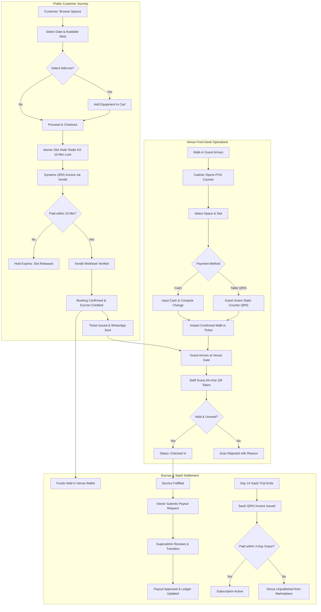

# AdaTempat: Product Requirements Document (PRD)

---

## 1. Executive Summary & Product Vision

### 1.1. Product Overview

**AdaTempat** is a hybrid platform that seamlessly unifies a **Public Discovery Booking Marketplace** and a **B2B SaaS Venue Management Operating System (OS)** for physical rental spaces in Indonesia.

The platform serves two complementary user groups:

1. **Public Consumers**: Discover rental venues, view live slot availability in real time, customize bookings with equipment add-ons, and pay instantly via Dynamic QRIS without waiting for manual WhatsApp chat responses from venue administrators.
2. **Venue Owners & Front-Desk Staff**: Operate multi-branch facilities with a modern B2B SaaS OS featuring a synchronized slot matrix, front-desk POS (cash & table QRIS), gate QR check-in scanning, customer self-service reschedule rules, escrow wallet management, and automated subscription billing with **0% rental commission**.

### 1.2. Physical Space Categories Supported

- **Sports Arenas**: Badminton, Futsal, Basketball, Tennis, Mini Soccer.
- **Meeting & Business Rooms**: Meeting rooms, Training facilities, Boardrooms, Workshop halls.
- **Creative Studios**: Podcast studios, Photography studios, Music rehearsal rooms, Dance studios.
- **Coworking & Workstations**: Hot desks, Dedicated desks, Private team offices.
- **Event Spaces**: Function halls, Multipurpose community spaces.

### 1.3. Core Problem Statement & Solutions

- **Manual WhatsApp Inquiries**: Slow response times (1–4 hours) cause booking friction and lost revenue.
  _Solution_: Direct online booking with real-time slot selection and instant QRIS payment.
- **Double-Booking Conflicts**: Online buyers clash with front-desk walk-in guests.
  _Solution_: Shared atomic Redis slot lock (10-minute hold) coupled with unique database constraints.
- **High Marketplace Commissions**: Traditional platforms charge 15% to 25% per booking.
  _Solution_: 0% rental transaction commission. Revenue is generated via flat monthly B2B SaaS subscriptions plus a minor consumer platform fee (IDR 1,500).
- **Gate Check-in Bottlenecks**: Paper logs and manual receipts slow down entry and allow ticket reuse.
  _Solution_: Cryptographic single-use 64-character QR tokens verified in under 3 seconds using browser-based camera scanners.
- **Disorganized Cash & Payout Management**: Scattered payment proofs and untracked cash drawers.
  _Solution_: Escrow-backed digital wallet with an append-only transaction ledger and Superadmin-verified bank payouts.

### 1.4. Key Success Metrics

- **Double-booking Rate**: Exactly 0 occurrences, guaranteed by Redis atomic locks and database transaction constraints.
- **End-to-End Online Checkout**: Under 2 minutes from slot selection to confirmed digital ticket.
- **Gate Check-in Latency**: Under 3 seconds per guest scan.
- **Automated Test Quality**: 100% green test suite across critical paths (concurrency, escrow ledger, RBAC, payments).
- **Free Trial to Paid Conversion**: Minimum 40% of 14-day trial venue owners upgrading to active SaaS tiers.

### 1.5. Target Technology Stack (Laravel 13)

- **Backend Framework**: PHP 8.3+, **Laravel 13** with modular service-repository architecture and strict type declarations.
- **Frontend Architecture**: **React 19 with TypeScript**
- **UI & Component System**: Tailwind CSS v4, Lucide React icons, accessible headless UI primitives (Radix UI / shadcn style components), and Geist font tokens.
- **Real-Time Layer**: Laravel Reverb WebSocket server with Laravel Echo on the React client for instant slot matrix state updates.
- **Cache & Concurrency**: Redis 8 for atomic 10-minute slot locks (`SET NX EX 600`), session storage, and asynchronous background queues.
- **Database Engine**: MySQL 8.0+ / PostgreSQL 16 with InnoDB, strict foreign key constraints, composite indexes, and transactional ACID guarantees.
- **Payment Gateway**: Xendit API for Dynamic QRIS generation and idempotent webhook verification.
- **Messaging Gateway**: WhatsApp Gateway (Fonnte/Waha) via asynchronous Redis queue workers with automated retry pipelines.

---

## 2. System Scope & MVP Boundaries

### 2.1. In-Scope Features (Current Production Baseline)

- **Public Marketplace**: Search by city, category, and date; rich space profiles; interactive gallery; amenity badges.
- **Real-Time Slot Engine**: Dynamic slot generation based on operating hours, custom pricing rules, and real-time availability updates.
- **Atomic 10-Minute Concurrency Lock**: Two-tier protection (Redis `SET NX EX 600` + database unique constraints) preventing collision between online customers and cashier walk-ins.
- **Equipment Add-ons**: Rentable equipment (rackets, balls, projectors) with per-hour, per-item, or per-booking pricing.
- **Customer Self-Service Reschedule**: Policy-driven schedule alterations (`free_reschedule`, `flexible_partial`, `strict_non_refundable`).
- **Dynamic QRIS Payment via Xendit**: Instant QR code generation, 10-minute expiry, and idempotent webhook confirmation.
- **Asynchronous WhatsApp Notifications**: Dispatching booking receipts and live ticket links via Fonnte/Waha background workers with automatic retries.
- **Front-Desk POS Counter**: Walk-in checkout supporting physical Cash (with change calculation) and Table QRIS (venue's static payment).
- **Gate QR Scanner**: In-browser camera scanning validating 64-character single-use tokens, checking venue authorization and entry time windows.
- **Venue Escrow Wallet**: Segregated pending and available balances with an immutable append-only ledger (`wallet_transactions`).
- **Superadmin Control Panel**: Global GMV metrics, multi-tenant venue auditing, payout approval with transfer receipt uploads, and SaaS subscription tracking.
- **B2B SaaS Subscription Engine**: 14-day free trial on signup, tier-based branch and staff quotas, and automated monthly invoice generation.

### 2.2. Explicitly Deferred to Future Releases

- Customer loyalty points, cashback programs, and seasonal promo vouchers.
- Recurring league/tournament bookings and monthly consumer memberships.
- Direct credit card, virtual account, and e-wallet tokenization (MVP focuses exclusively on national standard QRIS).
- Fully automated bank payout API disbursement (MVP relies on Superadmin manual transfer with receipt upload).
- Dark mode theme and multi-language localization (MVP operates in Bahasa Indonesia with English documentation).

---

## 3. User Personas & Access Control Matrix (RBAC)

| Feature / Page                      |  Public Guest  | Customer (`customer`) | Front-Desk Cashier (`staff`) |    Venue Owner (`owner`)    | Superadmin (`superadmin`) |
| :---------------------------------- | :------------: | :-------------------: | :--------------------------: | :-------------------------: | :-----------------------: |
| Browse Venues & Spaces              |      Yes       |          Yes          |             Yes              |             Yes             |            Yes            |
| View Real-Time Slot Matrix          |      Yes       |          Yes          |             Yes              |             Yes             |            Yes            |
| Hold Slot & Checkout Online         | Login Required |          Yes          |              No              |             No              |            No             |
| View Personal Bookings & Reschedule |       No       |          Yes          |              No              |             No              |            No             |
| POS Walk-in Counter                 |       No       |          No           |     Yes (Assigned Venue)     |             Yes             |      Read-Only Audit      |
| Gate QR Scanner                     |       No       |          No           |     Yes (Assigned Venue)     |             Yes             |      Read-Only Audit      |
| Manage Venues, Spaces & Add-ons     |       No       |          No           |              No              |             Yes             |      Read-Only Audit      |
| Manage Staff Accounts               |       No       |          No           |              No              | Yes (Subject to Plan Quota) |      Read-Only Audit      |
| Escrow Wallet & Request Payout      |       No       |          No           |              No              |             Yes             |      Read-Only Audit      |
| SaaS Subscription & Invoices        |       No       |          No           |              No              |             Yes             |     Manage / Override     |
| Superadmin GMV & Global Metrics     |       No       |          No           |              No              |             No              |            Yes            |
| Audit & Approve Venues              |       No       |          No           |              No              |             No              |            Yes            |
| Review & Disburse Payouts           |       No       |          No           |              No              |             No              |            Yes            |

_Multi-Tenant Data Isolation_: Every business owner and staff member is strictly scoped to their own `business_id` and assigned `venue_id`. Data access across organizational boundaries is denied by route middleware and Eloquent global scopes.

---

## 4. Information Architecture & Routing Catalog

All web routes are rendered via **Inertia.js React Pages** (`resources/js/Pages/`), providing full SPA speed, seamless transitions, and centralized Laravel controller routing (`Inertia::render`).

### 4.1. Public Marketplace (No Authentication Required)

- `/`: `Public/Home.tsx` - Homepage featuring hero search, popular categories, featured spaces, and business onboarding CTA.
- `/spaces`: `Public/SpaceBrowse.tsx` - Filterable catalog with search debounce, city dropdown, category tabs, and dual-thumb price range slider.
- `/v/{slug}`: `Public/VenueProfile.tsx` - Dedicated public microsite profile for a specific venue (cover photo, address, contact, bento grid of spaces).
- `/spaces/{slug}`: `Public/SpaceSlotPicker.tsx` - Space detail page with interactive 7-day date selector, real-time slot grid, add-on selector, and mobile sticky summary bar.
- `/checkout`: `Public/Checkout.tsx` - Multi-step booking form (Step 2 of Stepper) with iOS-safe 16px inputs, guest details, add-on review, and terms agreement.
- `/payment/{code}`: `Public/PaymentPage.tsx` - Dynamic QRIS payment page (Step 3) with a 10-minute countdown timer, high-contrast QRIS rendering, and auto-refresh live polling.
- `/tickets/{code}`: `Public/TicketView.tsx` - Digital boarding pass ticket (Step 4) with 64-character QR code, schedule breakdown, and Google Maps direction button.

### 4.2. Customer Portal (Role: `customer`)

- `/bookings/history`: `Customer/BookingHistory.tsx` - Customer dashboard with upcoming, completed, and canceled bookings, plus self-service reschedule modal.

### 4.3. Business Authentication

- `/login`: `Auth/Login.tsx` - Unified login for customers, venue staff, owners, and superadmins.
- `/register`: `Auth/Register.tsx` - Consumer registration.
- `/register/business`: `Auth/RegisterBusiness.tsx` - Business owner onboarding (initializes business profile, venue record, and activates 14-day free trial).

### 4.4. Venue Owner SaaS Portal (Role: `owner`, Prefix: `/owner`)

- `/owner/subscription`: `Owner/SubscriptionManager.tsx` - Active plan status, trial countdown, staff/venue usage meters, plan upgrade selection, and invoice history.
- `/owner/venues`: `Owner/VenueManager.tsx` - Branch management (CRUD venue, cover image upload, coordinates, operating status, publication toggle).
- `/owner/venues/{venueId}/spaces`: `Owner/SpaceManager.tsx` - Space configuration (operating hours, default slot duration, hourly rates, add-on inventory).
- `/owner/venues/{venueId}/wallet`: `Owner/WalletDashboard.tsx` - Financial dashboard (available balance, pending escrow, ledger table, payout request form).
- `/owner/staff`: `Owner/StaffManager.tsx` - Staff management (invite front-desk cashiers, assign specific venue branch permissions).

### 4.5. Front-Desk POS & Gate Operations (Roles: `staff`, `owner`, Prefix: `/pos`)

- `/pos/counter`: `Pos/Counter.tsx` - Front-desk cashier counter (select space, date, and vacant slots; execute instant `[CASH]` with change calculator or `[TABLE QRIS]`).
- `/pos/scanner`: `Pos/Scanner.tsx` - Gate check-in camera scanner (real-time QR code decoder via HTML5-QRCode React component, manual code input fallback, immediate Green/Red status badge).

### 4.6. Superadmin Control Center (Role: `superadmin`, Prefix: `/superadmin`)

- `/superadmin/dashboard`: `Superadmin/Dashboard.tsx` - Platform-wide GMV, total transaction volume, active venue count, and actionable pending queues.
- `/superadmin/venues`: `Superadmin/VenueAudit.tsx` - Venue directory, verification modal, and publication approval/rejection toggle.
- `/superadmin/payouts`: `Superadmin/PayoutManager.tsx` - Payout queue, bank account verification, payout approval modal with bank transfer receipt upload.

---

## 6. Core Business Workflows & Technical Rules

### 6.1. Real-Time Slot Generation & Matrix

- Operating slots are calculated dynamically by `SlotGeneratorService` based on `schedules` (open time, close time, slot duration: 30, 60, 90, or 120 minutes).
- Overlapping existing bookings (`booking_slots`), manual maintenance blocks (`space_custom_slots`), and expired times are excluded from availability.
- Multi-slot selection allows customers to reserve consecutive blocks (maximum 6 hours per transaction).

### 6.2. Two-Tier Atomic Slot Concurrency Lock

1. **Tier 1 (Redis In-Memory Lock)**:
    - On checkout submission, the system acquires an atomic lock: `SET lock:slot:{space_id}:{date}:{start_time} {booking_id} NX EX 600`.
    - All slots in the reservation must succeed together. If any individual slot fails, all acquired locks are immediately released (all-or-nothing rollback).
2. **Tier 2 (Database Source of Truth)**:
    - The transaction inserts into `booking_slots` with composite unique indexes.
    - If a duplicate key violation occurs, the transaction rolls back, releasing Redis keys and alerting the user that the slot was just claimed.
3. **Expiry Release**:
    - Holds expire automatically after 10 minutes (600 seconds).
    - If payment is not completed before expiry, scheduled tasks clean up pending holds and return the slot to the public pool.

### 6.3. Equipment Add-on System

- Spaces configure rentable add-ons (`space_add_ons`) with pricing models:
    - `per_hour`: Multiplied by the number of booked hours.
    - `per_item`: Multiplied by the requested quantity.
    - `per_booking`: Flat rate per reservation.
- Add-on amounts are recorded as `booking_add_ons` and factored into `bookings.addons_amount` and `bookings.total_amount`.

### 6.4. Customer Self-Service Reschedule Engine

Handled by `BookingRescheduleService` governed by `spaces.reschedule_policy`:

- **`free_reschedule`**: Permitted free of charge up to 6 hours before slot commencement.
- **`flexible_partial`**: Requires an administrative adjustment or voucher conversion.
- **`strict_non_refundable`**: Rescheduling blocked online; requires direct venue coordination.
- Every reschedule releases previous `booking_slots`, claims new atomic slots, and logs the change to `booking_reschedule_logs`.

### 6.5. Dynamic QRIS via Xendit

- `XenditPaymentService` generates a dynamic QRIS invoice with external ID format `ADT-YYYYMMDD-XXXX` and an exact 600-second duration.
- The webhook endpoint `POST /api/webhooks/xendit` processes callbacks with the following guarantees:
    - Token and signature verification.
    - Idempotent execution: Duplicate webhook delivery is ignored if the transaction is already marked `paid`.
    - On payment verification, booking status changes to `confirmed`, the wallet pending balance is credited, and WhatsApp delivery is queued.

### 6.6. Front-Desk POS Counter & Gate QR Scanner

1. **POS Counter**:
    - Cashier selects space and slot.
    - Option `[CASH]`: Cashier inputs cash received, change is computed, booking is instantly marked `confirmed` (`payment_method: cash`), and a digital ticket is generated.
    - Option `[TABLE QRIS]`: Customer scans venue's static desk QRIS, cashier confirms funds received, and booking is marked `confirmed`. Funds bypass platform escrow and go straight to the venue.
2. **Gate QR Scanner**:
    - Tickets contain a cryptographic 64-character token (`qr_checkin_token`).
    - Scanner validates:
        - Booking status must be `confirmed`.
        - Token must not be previously used (`checked_in_at` must be null).
        - Venue ID must match the scanner's authenticated venue.
        - Arrival time must fall within the allowed window (30 minutes prior to start time up to end time).
    - Valid scans set `status = checked_in` and record `checked_in_at = now()`.

### 6.7. Venue Escrow Wallet & Superadmin Payouts

- Online customer payments are held in `venue_wallets.balance`.
- Every credit and debit is tracked in `wallet_transactions` (append-only ledger recording transaction type, amount, resulting balance, and booking reference).
- Venue owners submit payout requests via `/owner/venues/{venueId}/wallet`.
- Superadmins review the request, verify bank account details, complete the manual transfer, and upload transfer proof before marking the payout `approved`.

### 6.8. B2B SaaS Subscription Engine

Managed by `SubscriptionBillingService`:

- **Starter Plan** (IDR 199,000 / month): Maximum 1 Venue, 2 Staff Accounts.
- **Pro Plan** (IDR 499,000 / month): Maximum 3 Venues, 5 Staff Accounts, Advanced Reports.
- **Enterprise Plan** (Custom Pricing): Unlimited Venues & Staff, SLA 99.9%.
- **Lifecycle**:
    - New business registrations receive 14 days of free trial (`trialing`).
    - On day 14, an automated Dynamic QRIS subscription invoice (`subscription_invoices`) is generated.
    - 3-day grace period (`past_due`). If unpaid after grace period, venue listings are hidden from the marketplace (`is_published = false`).

### 6.9. Asynchronous WhatsApp Notifications

- Managed by `WhatsAppNotificationService` via Redis queue `whatsapp-notifications`.
- Delivers booking confirmations, ticket QR links, and reminder notices through Fonnte/Waha gateway integration.
- Includes automated exponential backoff with up to 3 retries, logging delivery status to `notification_logs`.

---

## 7. System Architecture & Flowchart

---

## 8. Database Schema & Data Dictionary

### 8.1. `users`

- `id` (bigint, PK)
- `name` (string)
- `email` (string, unique)
- `phone` (string, nullable)
- `password` (string)
- `role` (enum: `superadmin`, `owner`, `staff`, `customer`)
- `remember_token`, `timestamps`

### 8.2. `businesses`

- `id` (bigint, PK)
- `user_id` (bigint, FK -> `users.id`, Owner)
- `name` (string)
- `legal_name` (string, nullable)
- `status` (enum: `active`, `suspended`)
- `timestamps`

### 8.3. `venues`

- `id` (bigint, PK)
- `business_id` (bigint, FK -> `businesses.id`)
- `name` (string)
- `slug` (string, unique)
- `city` (string, indexed)
- `address` (text)
- `cover_photo_path` (string, nullable)
- `contact_phone` (string, nullable)
- `is_published` (boolean, default false, indexed)
- `approval_status` (enum: `pending`, `approved`, `rejected`, default `pending`)
- `website_config` (json, nullable)
- `timestamps`

### 8.4. `spaces`

- `id` (bigint, PK)
- `venue_id` (bigint, FK -> `venues.id`)
- `name` (string)
- `slug` (string, unique)
- `category` (enum: `badminton`, `futsal`, `basketball`, `tennis`, `meeting`, `studio`, `coworking`, `event`, `other`)
- `capacity` (integer, nullable)
- `base_price` (decimal 12,2)
- `instant_book` (boolean, default true)
- `reschedule_policy` (enum: `free_reschedule`, `flexible_partial`, `strict_non_refundable`)
- `is_active` (boolean, default true, indexed)
- `timestamps`

### 8.5. `schedules`

- `id` (bigint, PK)
- `space_id` (bigint, FK -> `spaces.id`)
- `day_of_week` (tinyint: 0=Sunday, 6=Saturday)
- `open_time` (time)
- `close_time` (time)
- `slot_duration_minutes` (integer, default 60)
- `is_active` (boolean, default true)
- `timestamps`

### 8.6. `space_add_ons`

- `id` (bigint, PK)
- `space_id` (bigint, FK -> `spaces.id`)
- `name` (string)
- `price` (decimal 12,2)
- `pricing_type` (enum: `per_hour`, `per_item`, `per_booking`)
- `stock_quantity` (integer, default 1)
- `is_active` (boolean, default true)
- `timestamps`

### 8.7. `bookings`

- `id` (bigint, PK)
- `venue_id` (bigint, FK -> `venues.id`)
- `space_id` (bigint, FK -> `spaces.id`)
- `user_id` (bigint, nullable, FK -> `users.id`)
- `code` (string 20, unique, e.g., `ADT-20261103-9182`)
- `booking_date` (date, indexed)
- `start_time` (time)
- `end_time` (time)
- `customer_name` (string)
- `customer_phone` (string)
- `customer_email` (string, nullable)
- `notes` (text, nullable)
- `subtotal_amount` (decimal 12,2)
- `addons_amount` (decimal 12,2, default 0)
- `total_amount` (decimal 12,2)
- `status` (enum: `pending_payment`, `confirmed`, `checked_in`, `expired`, `cancelled`, `rescheduled`, indexed)
- `payment_method` (enum: `qris`, `cash`)
- `qr_checkin_token` (string 64, unique)
- `checked_in_at` (timestamp, nullable)
- `created_by` (bigint, nullable, FK -> `users.id`, cashier who handled walk-in)
- `timestamps`

### 8.8. `booking_slots`

- `id` (bigint, PK)
- `booking_id` (bigint, FK -> `bookings.id`)
- `space_id` (bigint, FK -> `spaces.id`)
- `slot_date` (date)
- `start_time` (time)
- `end_time` (time)
- `price` (decimal 12,2)
- `timestamps`
- _Composite Unique Index_: `(space_id, slot_date, start_time, end_time)`

### 8.9. `booking_add_ons`

- `id` (bigint, PK)
- `booking_id` (bigint, FK -> `bookings.id`)
- `space_add_on_id` (bigint, FK -> `space_add_ons.id`)
- `name` (string)
- `unit_price` (decimal 12,2)
- `quantity` (integer)
- `total_price` (decimal 12,2)
- `timestamps`

### 8.10. `booking_reschedule_logs`

- `id` (bigint, PK)
- `booking_id` (bigint, FK -> `bookings.id`)
- `previous_date` (date)
- `previous_start_time` (time)
- `previous_end_time` (time)
- `new_date` (date)
- `new_start_time` (time)
- `new_end_time` (time)
- `rescheduled_by` (bigint, FK -> `users.id`)
- `reason` (string, nullable)
- `timestamps`

### 8.11. `payment_transactions`

- `id` (bigint, PK)
- `booking_id` (bigint, FK -> `bookings.id`)
- `invoice_id` (string, unique, Xendit external reference)
- `payment_channel` (enum: `qris`, `cash_counter`, `qris_table`)
- `amount` (decimal 12,2)
- `status` (enum: `pending`, `paid`, `expired`, `failed`, indexed)
- `qr_string` (text, nullable)
- `paid_at` (timestamp, nullable)
- `payload` (json, nullable)
- `timestamps`

### 8.12. `venue_wallets`

- `id` (bigint, PK)
- `venue_id` (bigint, unique, FK -> `venues.id`)
- `balance` (decimal 14,2, default 0)
- `last_updated_at` (timestamp)
- `timestamps`

### 8.13. `wallet_transactions`

- `id` (bigint, PK)
- `venue_wallet_id` (bigint, FK -> `venue_wallets.id`)
- `booking_id` (bigint, nullable, FK -> `bookings.id`)
- `type` (enum: `credit_booking`, `debit_payout`, `debit_saas_fee`, `adjustment`, indexed)
- `amount` (decimal 12,2)
- `current_balance` (decimal 14,2)
- `description` (string)
- `created_at` (timestamp)

### 8.14. `payout_requests`

- `id` (bigint, PK)
- `venue_wallet_id` (bigint, FK -> `venue_wallets.id`)
- `user_id` (bigint, FK -> `users.id`, Owner)
- `amount` (decimal 12,2)
- `bank_name` (string)
- `account_number` (string)
- `account_holder` (string)
- `status` (enum: `requested`, `approved`, `rejected`, indexed)
- `processed_by` (bigint, nullable, FK -> `users.id`, Superadmin)
- `proof_path` (string, nullable)
- `reject_reason` (text, nullable)
- `timestamps`

### 8.15. `subscriptions` & `subscription_invoices`

- `subscriptions`: `id`, `business_id`, `plan_code` (starter, pro, enterprise), `status` (`trialing`, `active`, `past_due`, `cancelled`), `trial_ends_at`, `current_period_end`, `grace_ends_at`, `timestamps`.
- `subscription_invoices`: `id`, `subscription_id`, `invoice_code`, `amount`, `status` (`unpaid`, `paid`, `expired`), `due_at`, `paid_at`, `xendit_invoice_id`, `timestamps`.

### 8.16. `notification_logs`

- `id` (bigint, PK)
- `booking_id` (bigint, nullable, FK -> `bookings.id`)
- `channel` (enum: `whatsapp`, `email`)
- `recipient` (string)
- `status` (enum: `queued`, `sent`, `failed`)
- `retry_count` (integer, default 0)
- `error_message` (text, nullable)
- `sent_at` (timestamp, nullable)
- `timestamps`

---

## 9. Non-Functional Requirements

### 9.1. Concurrency & Data Integrity

- Simultaneous slot lock attempts must be serialized using Redis atomic primitives (`SET NX`).
- Multi-slot reservations must execute within an isolated database transaction, ensuring no partial bookings exist.

### 9.2. Security & Data Protection

- Strict tenant authorization policies prevent IDOR (Insecure Direct Object Reference) vulnerabilities between venue branches.
- Webhook callbacks from Xendit require HMAC token validation before any internal state change occurs.
- Gate ticket tokens are cryptographically randomized 64-character strings; raw sequential IDs are never exposed as entry tokens.

### 9.3. Performance & Caching

- Public marketplace and search endpoints must maintain average response times under 300ms.
- Slot matrix queries leverage Redis caching with event-driven invalidation whenever a slot status changes.
- Asset pipeline compiled with Vite and optimized via Tailwind CSS v4 JIT.

### 9.4. Search Engine Optimization (SEO) & SSR

- Server-Side Rendering (SSR) via Inertia.js SSR (`@inertiajs/react/server`) compiled with Vite ensures full search engine crawler indexability for all public marketplace and venue profile pages (`/spaces/{slug}`, `/v/{slug}`, `/`).
- Dynamic meta tags, OpenGraph tags, and JSON-LD structured data (`SportsActivityLocation`, `LocalBusiness`) embedded directly on initial server render.

---

## 10. Localization, Copywriting & Realistic Seed Data

- **Primary System Language**: Indonesian (Bahasa Indonesia) for user-facing copy and customer communications.
- **Currency & Date Conventions**:
    - Currency: `Rp 150.000` (formatted with `tabular-nums` in Geist Mono).
    - Date: `Senin, 3 November 2026`.
    - Time: 24-hour format with timezone suffix (e.g., `19:00 - 20:00 WITA / WIB`).
- **Standard Seed Venues**:
    - "GOR Badminton Smash Banjarbaru" (Badminton, Banjarbaru).
    - "Borneo Futsal Arena" (Futsal, Banjarmasin).
    - "Studio Karsa Podcast & Photo" (Studio, Banjarbaru).
    - "Ruang Kolaborasi Hub" (Coworking & Meeting Room, Banjarmasin).
