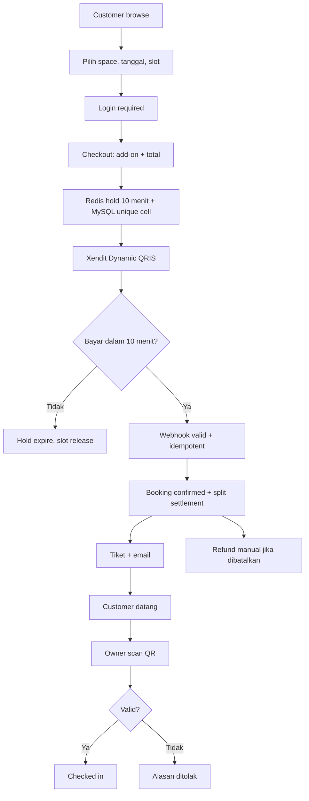

# AdaTempat: Product Requirements Document (Revised)

**Status:** Revised PRD — MVP baseline  
**Tanggal:** 4 November 2026  
**Sumber:** `adatempat-prd-original.md`  
**Review:** `review-report.md`  
**Perubahan utama:** MVP dipersempit ke booking online + QRIS + tiket + scanner + owner portal minimal + refund manual + approval venue; split settlement Xendit; MySQL 8; email sebagai kanal notifikasi MVP; POS, reschedule, wallet/payout, escrow, SaaS subscription, WhatsApp, dan dashboard GMV masuk Phase 2; fee konsumen Rp1.500 dihapus.

---

## 1. Executive Summary & Product Vision

### 1.1 Product Overview

**AdaTempat** adalah platform hybrid yang menyatukan:

1. **Public Discovery Booking Marketplace** — customer menemukan venue, melihat slot real-time, memilih add-on, membayar via QRIS, dan menerima tiket digital.
2. **Venue Management OS** — owner mengelola venue, space, jadwal, harga, add-on, dan approval; operasi front-desk (POS), staff, wallet, payout, dan SaaS subscription masuk Phase 2.

MVP berfokus pada transaksi online yang utuh: **browse → pilih slot → checkout → bayar QRIS → tiket → scan di gate → refund manual jika perlu**. Ini adalah irisan dengan risiko tertinggi dan nilai customer paling jelas.

### 1.2 Kategori Ruang

- Sports arenas: badminton, futsal, basketball, tennis, mini soccer.
- Meeting & business rooms: meeting room, training, boardroom, workshop.
- Creative studios: podcast, photo, music rehearsal, dance.
- Coworking & workstations: hot desk, dedicated desk, private office.
- Event spaces: function hall, multipurpose space.

### 1.3 Problems & Solutions

| Masalah | Solusi MVP |
| --- | --- |
| Inquiry WhatsApp lambat (1–4 jam) | Booking online dengan slot real-time dan QRIS instan. |
| Double booking online vs walk-in | Hold 10 menit dengan Redis + unique index canonical grid + row lock MySQL. |
| Komisi marketplace 15–25% | 0% komisi; MVP tanpa fee konsumen; monetisasi SaaS Phase 2. |
| Check-in manual/lambat | Tiket dengan token 64 karakter dan scanner kamera browser. |
| Refund tidak jelas | Policy pembatalan per space; refund manual oleh superadmin; audit trail. |
| Venue tidak terverifikasi | Approval superadmin sebelum publish ke marketplace. |

### 1.4 Success Metrics

Target awal yang harus divalidasi load test:

- **Double booking:** 0 pada test konkurensi untuk slot sama/overlap, termasuk perubahan durasi dan custom block.
- **Checkout online:** median < 2 menit dari pilih slot sampai tiket terbit.
- **Gate scan:** < 3 detik per scan pada perangkat target.
- **Email delivery:** > 98% untuk konfirmasi/tiket pada provider transaksional.
- **Webhook:** 100% event valid diproses idempotent; replay tidak menggandakan ledger/notifikasi.
- **Uptime MVP:** 99,5% bulanan (target awal).
- **Approval venue:** 100% venue publish melalui approval superadmin.
- **Refund:** 100% refund manual tercatat dengan bukti dan audit trail.

Klaim “0 double booking” adalah target yang diuji, bukan jaminan teoretis.

### 1.5 Technology Stack

- **Backend:** PHP 8.3–8.5, Laravel 13 (`^13.0`), service-repository modular, strict types.
- **Frontend:** React 19 + TypeScript, Inertia.js, Tailwind CSS v4, Radix/shadcn-style components, Lucide icons, Geist font.
- **SSR:** Inertia SSR (`@inertiajs/react/server`) untuk halaman publik/SEO.
- **Real-time:** Laravel Reverb + Laravel Echo untuk slot matrix; fallback polling.
- **Cache/concurrency:** Redis 8 (`SET NX EX 600` atau `Cache::lock`), queue, session.
- **Database:** MySQL 8 (final untuk MVP).
- **Payment:** Xendit QRIS + XenPlatform split settlement.
- **Email:** provider transaksional (dipilih saat implementasi), queue + retry.
- **WhatsApp:** Phase 2 (Fonnte/Waha), tidak menjadi dependency MVP.

### 1.6 Business Model

- **0% commission** untuk transaksi rental.
- **Tidak ada fee konsumen Rp1.500** di MVP.
- **MVP gratis untuk venue**; tidak ada subscription enforcement.
- **Monetisasi Phase 2:** SaaS subscription (Starter/Pro/Enterprise) dan fitur operasional lanjutan.
- **MDR QRIS ditanggung venue** sesuai ketentuan Bank Indonesia; tidak dibebankan ke konsumen.

Konsekuensi: MVP tidak menghasilkan pendapatan transaksi dan harus diperlakukan sebagai fase akuisisi/validasi.

---

## 2. Scope & MVP Boundaries

### 2.1 Phase 1 — MVP Launch

**Public marketplace**

- Homepage, search/filter by city, category, date, price.
- Venue profile dan space detail.
- Slot picker 7 hari dengan horizon booking 30 hari.
- Add-on equipment (opsional per space) dengan pricing `per_hour`, `per_item`, `per_booking`.
- Checkout wajib login.
- QRIS payment page dengan expiry 10 menit.
- Tiket digital dengan QR 64 karakter dan signed URL.
- Customer booking history upcoming/past.
- Email konfirmasi, tautan tiket, dan status refund.

**Owner portal minimal**

- CRUD venue (nama, alamat, kota, timezone, cover, kontak).
- CRUD space (kategori, kapasitas, harga, add-on, cancellation policy).
- CRUD jadwal mingguan (open/close, slot duration).
- Submit venue untuk approval; publish setelah approved.
- Tidak ada staff management, wallet, subscription, atau POS di MVP.

**Superadmin minimal**

- Approval/rejection venue dengan alasan.
- Refund manual dengan bukti transfer dan audit log.
- Audit log aksi sensitif.
- 2FA wajib.
- Tidak ada dashboard GMV penuh di MVP.

**Gate**

- Scanner kamera browser untuk tiket.
- Validasi status, token single-use, venue, dan window waktu.
- Manual code input fallback.

**Operasional**

- Hold 10 menit; cleanup job.
- Webhook Xendit idempotent.
- Refund manual superadmin.
- Cancellation policy per space.
- Email queue + retry.
- Audit trail untuk approval/refund.

### 2.2 Phase 2

- POS counter: cash dan table QRIS.
- Staff management dan assignment ke venue.
- Self-service reschedule (free/partial/strict).
- Wallet, payout manual, escrow, ledger penuh.
- SaaS subscription: trial 14 hari, plan Starter/Pro/Enterprise, invoice, dunning, publish/unpublish.
- WhatsApp notifications.
- Dashboard GMV dan laporan lanjutan.
- Auto refund via Xendit.
- Reminder booking.
- Maintenance block/custom slot.
- Gallery media dan website config lanjutan.
- Dispute/no-show workflow lanjutan.

### 2.3 Explicitly Deferred

- Loyalty points, cashback, promo voucher.
- Recurring league/tournament bookings, memberships.
- Credit card, virtual account, e-wallet tokenization selain QRIS.
- Automated payout API.
- Dark mode dan multi-language.
- Native mobile apps.
- Multi-currency.

---

## 3. Personas & RBAC

### 3.1 Roles

| Role | MVP | Deskripsi |
| --- | --- | --- |
| `customer` | Ya | Booking online, melihat tiket/history, refund status. |
| `owner` | Ya | Mengelola venue/space/schedule, scan tiket, melihat refund. |
| `superadmin` | Ya | Approval venue, refund manual, audit, 2FA. |
| `staff` | Phase 2 | Front-desk/POS dan scanner untuk venue yang ditugaskan. |

### 3.2 Access Matrix

| Feature/Page | Public | Customer | Owner | Superadmin | Staff (Phase 2) |
| --- | --- | --- | --- | --- | --- |
| Browse venues/spaces | Yes | Yes | Yes | Yes | Yes |
| View slot matrix | Yes | Yes | Yes | Yes | Yes |
| Checkout online | Login required | Yes | No | No | No |
| Personal bookings/history | No | Yes | No | No | No |
| Gate scanner | No | No | Yes (own venue) | Audit | Yes (assigned venue) |
| Manage venues/spaces/schedules | No | No | Yes | Read-only audit | No |
| Approve/reject venue | No | No | No | Yes | No |
| Manual refund | No | Request/status | View | Yes | No |
| POS counter | No | No | Phase 2 | Audit | Phase 2 |
| Wallet/payout | No | No | Phase 2 | Phase 2 | No |
| SaaS subscription | No | No | Phase 2 | Phase 2 | No |
| GMV dashboard | No | No | No | Phase 2 | No |

### 3.3 Tenant Isolation

- Semua query owner/staff dibatasi `business_id` dan `venue_id`.
- Policy + Eloquent global scope; route middleware.
- Test IDOR untuk setiap endpoint owner/superadmin.
- Superadmin read-only audit tidak otomatis boleh mengubah data venue.

---

## 4. Information Architecture & Routes

### 4.1 Public

- `/` — `Public/Home.tsx`: hero search, kategori, venue unggulan, CTA owner.
- `/spaces` — `Public/SpaceBrowse.tsx`: filter kota, kategori, tanggal, harga.
- `/v/{slug}` — `Public/VenueProfile.tsx`: profil venue, cover, alamat, kontak, daftar space.
- `/spaces/{slug}` — `Public/SpaceSlotPicker.tsx`: detail space, date selector 7 hari, slot grid, add-on, sticky summary.
- `/checkout` — `Public/Checkout.tsx`: wajib login; data customer, add-on, total, terms.
- `/payment/{code}` — `Public/PaymentPage.tsx`: QRIS, countdown 10 menit, polling status.
- `/tickets/{code}` — `Public/TicketView.tsx`: signed URL, QR 64 karakter, jadwal, maps, `noindex`.
- `/login`, `/register`, `/register/business`.

### 4.2 Customer

- `/bookings` — `Customer/BookingHistory.tsx`: upcoming/past, tiket, status refund, aksi batalkan booking + refund quote; tanpa reschedule.

### 4.3 Owner

- `/owner/venues` — `Owner/VenueManager.tsx`: CRUD venue, cover, timezone, submit approval, publish toggle.
- `/owner/venues/{venueId}/spaces` — `Owner/SpaceManager.tsx`: CRUD space, harga, add-on, cancellation policy, jadwal.
- `/owner/venues/{venueId}/spaces/{spaceId}/schedules` — schedule editor.
- `/gate/scanner` — `Gate/Scanner.tsx`: scanner kamera + manual input.

### 4.4 Superadmin

- `/superadmin/venues` — `Superadmin/VenueAudit.tsx`: approval/rejection, alasan, audit.
- `/superadmin/refunds` — `Superadmin/RefundManager.tsx`: antrean refund, bukti, proses manual.
- `/superadmin/audit` — `Superadmin/AuditLog.tsx`.

### 4.5 Phase 2 Routes

- `/pos/counter` — POS cash/table QRIS.
- `/owner/staff` — staff management.
- `/owner/subscription` — SaaS subscription.
- `/owner/venues/{venueId}/wallet` — wallet/payout.
- `/superadmin/payouts` — payout approval.
- `/superadmin/dashboard` — GMV dashboard.

---

## 5. Core Workflows & Business Rules

### 5.1 Slot Generation, Horizon & Timezone

- Slot dihitung dari `schedules` per space per hari: open time, close time, slot duration (30/60/90/120 menit).
- Horizon booking **30 hari ke depan**. Tanggal di luar horizon ditolak sebelum hold.
- Slot yang overlap dengan booking aktif, maintenance block (Phase 2), atau waktu lampau tidak tersedia.
- Multi-slot maksimum 6 jam per transaksi.
- Setiap venue punya `timezone` IANA (`Asia/Jakarta`, `Asia/Makassar`, `Asia/Jayapura`).
- Timestamp disimpan UTC; tanggal/jam booking disimpan sebagai waktu lokal venue + timezone.
- Perubahan `slot_duration` harus future-dated dan tidak boleh menimpa tanggal yang sudah punya booking aktif; sistem memvalidasi overlap terhadap booking lama.
- `schedule_versions` menyimpan versi jadwal; booking lama merujuk versi saat dibuat.

### 5.2 Concurrency & 10-Minute Hold

**Tier 1 — Redis**

- Saat checkout, acquire lock atomik per slot: `lock:slot:{space_id}:{date}:{start_time}` dengan TTL 600 detik.
- Multi-slot harus all-or-nothing: jika satu lock gagal, semua lock yang sudah didapat dilepas.
- Redis Cluster memakai hash tag `{space_id}:{date}` agar multi-key operation tidak terpecah antar-node.

**Tier 2 — MySQL**

- Canonical grid: setiap slot adalah sel grid dengan unique index `(space_id, slot_date, start_time)`.
- Sebelum insert, transaksi mengambil row lock per `(space_id, slot_date)` (mis. tabel `slot_locks` atau `SELECT ... FOR UPDATE` pada row penjadwal).
- Validasi overlap range dilakukan dalam transaksi yang sama.
- Jika unique violation/overlap, transaksi rollback dan semua lock Redis dilepas.
- Jangan mengandalkan unique index exact `(start_time, end_time)`; MySQL tidak punya exclusion constraint.

**Expiry & cleanup**

- Hold expire setelah 600 detik.
- Scheduler menandai booking `expired`, melepas slot, dan menghapus/menutup hold.
- Booking `pending_payment` yang expired tidak boleh di-confirm oleh webhook telat.
- Webhook `paid` setelah expiry memicu `refund_pending`; slot tidak otomatis diklaim kembali.
- Jika slot masih kosong, customer boleh ditawari re-confirm, tetapi tidak otomatis.

### 5.3 Checkout & QRIS Payment

1. Customer login, memilih slot dan add-on.
2. Sistem membuat booking `pending_payment`, mengunci slot 10 menit, dan membuat invoice Xendit.
3. Xendit membuat Dynamic QRIS dengan expiry 600 detik dan external ID unik (`ADT-{ULID}` atau format unik lain; jangan memakai 4 digit acak).
4. Customer membayar QRIS.
5. Webhook Xendit diverifikasi sesuai produk:
   - `x-callback-token` untuk produk yang memakai token.
   - `X-Callback-Signature` HMAC SHA256 + `X-Callback-Timestamp` untuk Payment Status Callback.
6. Webhook idempotent berdasarkan `event_id`/`payment_id`; event duplikat tidak mengubah ledger/notifikasi dua kali.
7. Jika booking masih valid: status `confirmed`, tiket diterbitkan, email diqueue.
8. Jika booking sudah `expired`: status payment `refund_pending`; refund manual superadmin; tidak confirm.
9. Split settlement Xendit mengarahkan 100% nilai rental ke venue setelah biaya gateway; platform tidak mengambil komisi dan tidak menahan dana.
10. Jika split settlement belum tersedia untuk venue: fallback QRIS langsung ke venue dengan konfirmasi manual (pilot-only, bukan jalur scale).

**Aturan nominal**

- Total = subtotal slot + add-on. Tidak ada fee konsumen.
- IDR tidak memakai sen; pembulatan ke rupiah penuh di boundary pembayaran.
- MDR ditanggung venue; tidak dibebankan ke customer.
- Refund amount mengikuti cancellation policy dan ketentuan Xendit; MDR yang sudah terlanjur dipotong tidak otomatis kembali.

### 5.4 Ticket & Gate Scanner

- Setiap booking `confirmed` memiliki `qr_checkin_token` 64 karakter CSPRNG.
- Tiket diakses via signed URL dengan expiry; `noindex`; jangan menaruh token di URL yang mudah di-log.
- Scanner memvalidasi:
  - Booking `confirmed`.
  - Token belum dipakai (`checked_in_at` null).
  - Venue cocok dengan scanner.
  - Waktu scan berada dalam window 30 menit sebelum start sampai end time.
- Scan valid: status `checked_in`, `checked_in_at = now()`, token tidak dapat dipakai ulang.
- Scan invalid: alasan jelas (status, token, venue, window).
- Scanner tersedia untuk owner di MVP; staff Phase 2.

### 5.5 Cancellation & Refund

- Setiap space memiliki `cancellation_policy`:
  - `free_cancellation`: refund sesuai persentase (default 100%) sebelum cutoff.
  - `partial_refund`: refund sebagian (default 50%) sebelum cutoff.
  - `non_refundable`: tidak ada refund online.
- `cancellation_cutoff_hours` menentukan batas waktu (default 6 jam sebelum start).
- Customer dapat mengajukan pembatalan dari booking history; sistem menghitung refund quote.
- Refund diproses **manual oleh superadmin** di MVP:
  1. Superadmin memverifikasi policy, pembayaran, dan rekening customer.
  2. Refund diproses via dashboard/refund Xendit pada transaksi asal bila tersedia; jika tidak, transfer bank dan bukti diunggah.
  3. `refunds` mencatat amount, status, actor, bukti, dan `xendit_refund_id` bila ada.
  4. Booking `cancelled`; payment `refund_pending` → `refunded`; customer melihat status.
- Karena split settlement tidak menahan dana di platform, refund harus memakai mekanisme Xendit atau melibatkan transfer venue ke platform; jangan mengandalkan saldo platform.
- Auto refund via Xendit masuk Phase 2.

### 5.6 Venue Onboarding & Approval

1. Owner register business (`/register/business`) dan membuat venue.
2. Owner melengkapi venue, space, schedule, harga, add-on, cover, timezone.
3. Owner submit venue untuk approval.
4. Venue berstatus `pending`; **tidak tampil** di marketplace.
5. Superadmin review dan approve/reject dengan alasan.
6. `approved` → owner boleh `is_published = true`; `rejected` tetap tersembunyi.
7. Perubahan material (nama/alamat) dapat memicu review ulang; perubahan harga/jadwal tidak.
8. Superadmin dapat unpublish venue karena pelanggaran/kualitas.

### 5.7 Owner Portal Minimal

- Venue: nama, slug, kota, alamat, timezone, cover, kontak, publish toggle.
- Space: nama, slug, kategori, kapasitas, base price, instant book, cancellation policy, add-on.
- Schedule: hari, open/close, slot duration.
- Add-on: nama, harga, pricing type, stok, aktif.
- Rumus add-on: `per_hour` × durasi jam, `per_item` × quantity, `per_booking` flat. Stok dikurangi saat booking `confirmed`; jika stok tidak cukup, checkout ditolak.
- Tidak ada staff, wallet, subscription, atau POS di MVP.
- Semua aksi material masuk audit log.

### 5.8 Customer Booking History

- `/bookings` menampilkan upcoming/past.
- Detail: kode booking, venue/space, tanggal/jam, add-on, total, status, tiket, status refund.
- Tidak ada tombol reschedule di MVP.
- Tiket tetap dapat diakses via email dan signed URL.

### 5.9 Superadmin Minimal

- Approval/rejection venue + alasan.
- Refund manual + bukti + status.
- Audit log aksi sensitif (approval, refund, unpublish, 2FA).
- 2FA wajib.
- Tidak ada dashboard GMV penuh di MVP.

### 5.10 Email Notifications

- Kanal MVP: email transaksional.
- Template: konfirmasi booking, tautan tiket, pembatalan/refund status, reminder (Phase 2).
- Queue Redis + retry exponential backoff (maksimum 3).
- `notification_logs` mencatat queued/sent/failed, retry, error.
- SPF/DKIM/DMARC wajib; provider dipilih saat implementasi.
- WhatsApp Phase 2; tidak ada dependency Fonnte/Waha di MVP.

### 5.11 Phase 2 Workflows (Ringkas)

- **POS:** cash dengan kembalian, table QRIS statis, walk-in ticket, `payment_method = cash|qris_table`, dana langsung ke venue.
- **Reschedule:** policy per space, release slot lama, claim slot baru, log; tidak ada refund otomatis.
- **Wallet/payout/escrow:** hanya setelah sign-off legal; ledger append-only; payout manual; trust account.
- **SaaS subscription:** trial 14 hari, plan, invoice QRIS, grace 3 hari, unpublish jika tidak bayar; jangan debit wallet.
- **WhatsApp:** queue, retry, template, opt-in.
- **GMV dashboard:** metrik platform, venue, payout.
- **Auto refund:** Xendit refund API.
- **Reminder:** email/WhatsApp H-1/H-2 jam.

---

## 6. System Architecture

### 6.1 MVP Flow



### 6.2 Components

- **Laravel 13** — API/controller, service domain, policy, queue, scheduler.
- **Inertia + React 19 + SSR** — halaman publik/SEO dan portal.
- **MySQL 8** — source of truth; canonical grid; unique constraints; row locks.
- **Redis 8** — slot locks, cache, queue, session.
- **Reverb** — update slot matrix; fallback polling.
- **Xendit** — QRIS, webhook, split settlement.
- **Email provider** — konfirmasi/tiket.
- **Object storage privat** — cover, bukti refund.
- **Observability** — log, metric, trace, alert.

### 6.3 Money Flow

```text
Customer → QRIS → Xendit
Xendit → split rule (setelah biaya gateway) → venue sub-account (100% rental)
Platform → 0% komisi, 0 fee konsumen
SaaS subscription → Phase 2, terpisah dari transaksi rental
```

Tidak ada escrow/wallet platform di MVP. `venue_wallets`, `wallet_transactions`, dan `payout_requests` adalah desain Phase 2, bukan migrasi MVP.

---

## 7. Database Schema & Data Dictionary

### 7.1 Prinsip

- MySQL 8; InnoDB; FK dan composite index.
- Uang: `decimal(12,2)` untuk nominal; IDR dibulatkan ke rupiah penuh di boundary pembayaran.
- Timestamp UTC; tanggal/jam booking disimpan sebagai waktu lokal venue + timezone.
- Ledger/audit append-only untuk refund dan aksi sensitif.
- Tabel Phase 2 tidak dibuat di migrasi MVP.

### 7.2 Tabel MVP

#### `users`

- `id` bigint PK
- `name` string
- `email` string unique
- `email_verified_at` timestamp nullable
- `phone` string nullable
- `password` string
- `role` enum `superadmin`, `owner`, `customer` (staff Phase 2)
- `two_factor_secret`/`two_factor_recovery_codes` nullable untuk superadmin
- `remember_token`, timestamps

#### `businesses`

- `id` bigint PK
- `user_id` FK `users.id` (owner)
- `name` string
- `legal_name` string nullable
- `status` enum `active`, `suspended`
- timestamps

#### `venues`

- `id` bigint PK
- `business_id` FK
- `name`, `slug` unique
- `city` indexed
- `address` text
- `timezone` string (IANA)
- `cover_photo_path` nullable
- `contact_phone` nullable
- `is_published` boolean default false, indexed
- `approval_status` enum `pending`, `approved`, `rejected`, default pending
- `approved_at`, `approved_by` FK users, `rejection_reason` text nullable
- `website_config` json nullable (Phase 2)
- timestamps

#### `spaces`

- `id` bigint PK
- `venue_id` FK
- `name`, `slug` unique
- `category` enum badminton/futsal/basketball/tennis/meeting/studio/coworking/event/other
- `capacity` int nullable
- `base_price` decimal(12,2)
- `instant_book` boolean default true
- `cancellation_policy` enum `free_cancellation`, `partial_refund`, `non_refundable`
- `cancellation_cutoff_hours` int default 6
- `refund_percentage` decimal(5,2) default 100
- `reschedule_policy` enum (`free_reschedule`, `flexible_partial`, `strict_non_refundable`) — Phase 2
- `is_active` boolean default true, indexed
- timestamps

#### `space_schedule_versions`

- `id` bigint PK
- `space_id` FK
- `version` int
- `effective_from` date
- `effective_to` date nullable
- `created_by` FK users
- timestamps
- unique `(space_id, version)`

#### `schedules`

- `id` bigint PK
- `space_id` FK
- `schedule_version_id` FK
- `day_of_week` tinyint (0=Sunday, 6=Saturday)
- `open_time` time
- `close_time` time
- `slot_duration_minutes` int default 60
- `is_active` boolean default true
- timestamps
- unique `(space_id, schedule_version_id, day_of_week, open_time)`

#### `amenities` & `space_amenities`

- `amenities`: `id`, `name`, `icon`, `category`, timestamps.
- `space_amenities`: `space_id`, `amenity_id`, unique `(space_id, amenity_id)`.

#### `space_add_ons`

- `id`, `space_id`, `name`, `price` decimal(12,2), `pricing_type` enum `per_hour`, `per_item`, `per_booking`, `stock_quantity` int default 1, `is_active` boolean default true, timestamps.

#### `bookings`

- `id` bigint PK
- `venue_id` FK
- `space_id` FK
- `user_id` FK nullable (online non-null; walk-in Phase 2 nullable)
- `code` string unique
- `booking_date` date indexed
- `start_time`, `end_time` time
- `customer_name`, `customer_phone`, `customer_email` nullable
- `notes` text nullable
- `subtotal_amount`, `addons_amount`, `total_amount` decimal(12,2)
- `status` enum `pending_payment`, `confirmed`, `checked_in`, `expired`, `cancelled`, `no_show` (rescheduled Phase 2), indexed
- `payment_method` enum `qris` (cash/qris_table Phase 2)
- `qr_checkin_token` string 64 unique
- `checked_in_at` timestamp nullable
- `cancelled_at`, `cancelled_by` FK users nullable
- `cancellation_policy_snapshot` json nullable
- `refund_amount` decimal(12,2) default 0
- `created_by` FK users nullable (Phase 2 walk-in)
- timestamps
- index `(space_id, booking_date, status)`, `(user_id, booking_date)`

#### `booking_slots`

- `id` bigint PK
- `booking_id` FK
- `space_id` FK
- `schedule_version_id` FK
- `slot_date` date
- `start_time`, `end_time` time
- `price` decimal(12,2)
- timestamps
- **unique `(space_id, slot_date, start_time)`** — canonical grid cell.
- index `(booking_id)`, `(space_id, slot_date)`

#### `booking_add_ons`

- `id`, `booking_id`, `space_add_on_id`, `name`, `unit_price`, `quantity`, `total_price`, timestamps.

#### `payment_transactions`

- `id` bigint PK
- `booking_id` FK (MVP non-null)
- `invoice_id` string unique (Xendit external ID)
- `xendit_payment_id` string nullable
- `payment_channel` enum `qris` (cash/qris_table Phase 2)
- `amount` decimal(12,2)
- `status` enum `pending`, `paid`, `expired`, `failed`, `refund_pending`, `refunded`, indexed
- `qr_string` text nullable
- `expires_at` timestamp
- `paid_at` timestamp nullable
- `idempotency_key` string unique nullable
- `payload` json nullable
- timestamps
- index `(status, expires_at)`

#### `refunds`

- `id` bigint PK
- `booking_id` FK
- `payment_transaction_id` FK
- `amount` decimal(12,2)
- `reason` string
- `status` enum `requested`, `approved`, `processing`, `succeeded`, `failed`, indexed
- `customer_bank_account` json nullable
- `proof_path` string nullable
- `xendit_refund_id` string nullable
- `requested_by`, `processed_by` FK users nullable
- `processed_at` timestamp nullable
- timestamps

#### `audit_logs`

- `id` bigint PK
- `actor_id` FK users nullable
- `action` string indexed
- `subject_type`, `subject_id`
- `before` json nullable, `after` json nullable
- `ip`, `user_agent` nullable
- `created_at`

#### `notification_logs`

- `id`, `booking_id` nullable, `channel` enum `email` (whatsapp Phase 2), `recipient`, `template`, `status` enum `queued`, `sent`, `failed`, `retry_count`, `error_message`, `sent_at`, timestamps.

### 7.3 Tabel Phase 2 (tidak dibuat di MVP)

- `staff_venue_assignments`
- `space_custom_slots`
- `venue_media` (gallery; cover MVP tetap di `venues.cover_photo_path`)
- `booking_reschedule_logs`
- `venue_wallets`
- `wallet_transactions`
- `payout_requests`
- `subscriptions`
- `subscription_invoices`
- `subscription_payments`
- `notification_templates`
- `platform_revenue` (jika ada fee/komisi di masa depan)

### 7.4 Constraint & Index Penting

- Unique `booking_slots (space_id, slot_date, start_time)`.
- Unique `bookings.code`, `payment_transactions.invoice_id`, `bookings.qr_checkin_token`.
- FK restrict untuk data keuangan; archive daripada delete.
- Index `bookings (space_id, booking_date, status)`, `bookings (user_id, booking_date)`.
- Index `refunds (status, created_at)`, `audit_logs (created_at)`, `notification_logs (status)`.
- `venues.approval_status` + `is_published` composite index untuk marketplace.

---

## 8. Non-Functional Requirements

### 8.1 Concurrency & Data Integrity

- Lock slot dengan Redis `SET NX EX 600`/`Cache::lock`; all-or-nothing.
- DB canonical grid + unique cell + row lock; validasi overlap.
- Test paralel dengan beberapa worker; tidak boleh ada double booking.
- Refund ledger/audit append-only; invariant saldo (Phase 2 wallet) diuji.

### 8.2 Security

- Webhook auth sesuai produk Xendit; reject invalid; log.
- Idempotency `event_id`/`payment_id`; replay-safe.
- Tenant isolation policy/global scope; IDOR test.
- Signed URL tiket + expiry; `noindex`.
- Superadmin 2FA; audit approval/refund/unpublish.
- Rate limit login, checkout, hold, scan, webhook.
- Upload cover/bukti privat; validasi MIME/ukuran; signed URL.
- PII minimization/encryption; consent, retensi, deletion UU PDP.
- Secrets di env/secret manager; rotasi.

### 8.3 Performance (Target Awal)

- Public browse/detail: p95 < 300ms pada profil beban yang disepakati (baseline awal 100 concurrent users); p99 dipantau, target ditetapkan setelah load test.
- Checkout/hold: p95 < 500ms; p99 < 1 detik.
- Webhook processing: < 5 detik sampai enqueue.
- Gate scan: < 3 detik.
- Uptime: 99,5% bulanan.
- Queue lag: < 60 detik untuk email.
- Cache: slot matrix di Redis; invalidasi event-driven.
- SSR: cache public pages; Vite optimized.

### 8.4 Reliability & Observability

- Backup harian; RPO 24 jam; RTO 4 jam (target awal).
- Health check app, DB, Redis, queue, Reverb.
- Structured logging dengan correlation ID.
- Metrics: latency, error rate, queue depth, webhook failure, scan failure.
- Alert untuk error rate, queue lag, webhook failures, DB/Redis down.

### 8.5 SEO & SSR

- SSR untuk `/`, `/spaces`, `/v/{slug}`, `/spaces/{slug}`.
- Meta/OG/JSON-LD `SportsActivityLocation`, `LocalBusiness`.
- Sitemap/robots; payment/ticket `noindex`.
- Fallback jika SSR Node down: static/CSR fallback dengan alert.

### 8.6 Accessibility & Responsive

- Keyboard navigation, focus states, ARIA labels.
- Kontras WCAG AA.
- Mobile-first; sticky summary; 16px input iOS.
- Reduced motion.

### 8.7 Testing Strategy

- Unit: state machine, pricing, add-on, overlap, ledger/refund, timezone.
- Integration: DB constraint, Redis lock parallel, webhook idempotency, queue retry, upload, signed URL.
- Contract: Xendit sandbox QRIS/webhook/split; email provider mock; WhatsApp Phase 2.
- Concurrency: multiple workers same slot; exactly one booking.
- E2E: owner CRUD → approval → browse → checkout → pay → ticket → scan → refund → customer history.
- Security: RBAC/IDOR, signed URL, rate limit, replay, upload, dependency scan.
- Load: profile from forecast; p95/p99, error rate, queue lag.
- Boundary: 30 days accepted, 31 rejected; timezone venue.
- CI gate: P0 tests pass; coverage not a goal by itself.

---

## 9. Localization, Copy & Seed Data

- Bahasa Indonesia untuk user-facing copy; English untuk identifier teknis.
- Currency: `Rp 150.000`; `tabular-nums` di Geist Mono.
- Date: `Senin, 3 November 2026`.
- Time: 24-hour + timezone (`19:00–20:00 WITA`).
- Email templates: konfirmasi, tiket, refund.
- Seed venues:
  - GOR Badminton Smash Banjarbaru (Badminton, Banjarbaru, WITA).
  - Borneo Futsal Arena (Futsal, Banjarmasin, WITA).
  - Studio Karsa Podcast & Photo (Studio, Banjarbaru, WITA).
  - Ruang Kolaborasi Hub (Coworking/Meeting, Banjarmasin, WITA).
- Seed users: superadmin, owner, customer; password dev-only.
- Seed schedule/harga/add-on realistis; jangan memakai PII produksi.

---

## 10. Phase Plan, Risks & Launch Criteria

### 10.1 Phase 1 — MVP Slices

1. **Foundation:** auth/RBAC, business/venue, owner portal minimal, approval venue, audit log, 2FA superadmin.
2. **Marketplace & slot:** katalog, venue/space, schedule, canonical grid, horizon 30 hari, timezone.
3. **Checkout & payment:** hold 10 menit, QRIS split settlement, webhook idempotent, tiket, email.
4. **Gate & customer:** scanner, booking history, cancellation/refund manual.
5. **Hardening:** concurrency, ledger/refund invariant, RBAC/IDOR, load test, security review, email deliverability.

### 10.2 Phase 2

POS, staff, reschedule, wallet/payout/escrow, SaaS subscription, WhatsApp, GMV dashboard, auto refund, reminder, maintenance block, gallery, reports.

### 10.3 Phase 2 SaaS (Indikatif)

| Plan | Harga | Kuota |
| --- | --- | --- |
| Starter | IDR 199.000/bulan | 1 venue, 2 staff |
| Pro | IDR 499.000/bulan | 3 venue, 5 staff, laporan lanjutan |
| Enterprise | Custom | Unlimited, SLA 99,9% |

Harga dan kuota harus divalidasi sebelum Phase 2; bukan bagian MVP.

### 10.4 Risks & Mitigations

| Risiko | Mitigasi |
| --- | --- |
| Split settlement/KYC venue | Konfirmasi Xendit; fallback QRIS langsung dengan konfirmasi manual (pilot). |
| Refund tanpa escrow | Xendit refund pada transaksi asal; jika tidak tersedia, venue transfer ke platform atau platform menalangi + tagih venue. |
| MDR/pajak | Validasi Xendit/konsultan; MDR ditanggung venue; buat kebijakan refund MDR. |
| Legal PJP/escrow | Escrow Phase 2; sign-off legal/partner berlisensi. |
| UU PDP | Consent, retensi, enkripsi, akses minimum, kebijakan privasi. |
| MySQL overlap | Canonical grid + unique cell + row lock + parallel test. |
| SSR/Reverb | Fallback polling; observability; load test; biaya hosting. |
| Email deliverability | Provider transaksional, SPF/DKIM/DMARC, retry, log. |
| Adopsi venue | Seed venues, onboarding playbook, feedback loop. |
| Pendapatan MVP | MVP gratis; anggarkan sebagai akuisisi; siapkan konversi SaaS Phase 2. |

### 10.5 Launch Criteria

- Tidak ada double booking pada test konkurensi.
- Webhook replay tidak menggandakan kredit/notifikasi.
- Refund manual tercatat, bukti privat, status customer terlihat.
- Venue `pending` tidak tampil; approval bekerja.
- Checkout wajib login; horizon 30 hari ditegakkan.
- Email konfirmasi/tiket terkirim; tidak ada dependency WhatsApp.
- p95/p99 dan queue lag memenuhi target awal atau target direvisi dengan alasan.
- `review-report.md` dan `adatempat-prd-revised.md` tersedia; PRD asli tidak berubah.

### 10.6 Open Verification

- Konfirmasi produk Xendit: QR Code vs Payment Request; webhook auth; split settlement/KYC; refund API.
- Pilih email provider dan domain.
- Tetapkan profil beban final.
- Review legal PJP/UU PDP/pajak.
- Validasi harga SaaS Phase 2.
- Konfirmasi apakah add-on tetap MVP atau ditunda (default: tetap MVP).

---

## 11. Related Documents

- `adatempat-prd-original.md` — PRD sumber.
- `review-report.md` — review P0/P1/P2, keputusan, risiko.
- `implementation-plan.md` — rencana eksekusi Sprint 0–6 dan chunk backlog.
- Xendit, “Handling webhooks” — https://docs.xendit.co/docs/handling-webhooks
- Xendit, “Route & split payments for sub-accounts” — https://docs.xendit.co/docs/split-payments
- Xendit, “XenPlatform” — https://www.xendit.co/en/products/xenplatform
- Bank Indonesia, “MDR QRIS Bagi Merchant” — https://www.bi.go.id/id/publikasi/ruang-media/cerita-bi/Pages/mdr-qris.aspx
- Laravel, “Release Notes 13.x” — https://laravel.com/framework/docs/releases
- Laravel News, “Laravel 13 Released” — https://laravel-news.com/laravel-13-released
- UU No. 27/2022 tentang Pelindungan Data Pribadi.
- Inertia.js SSR — https://inertiajs.com/server-side-rendering
- Redis, “SET” — https://redis.io/docs/latest/commands/set/

---

**Catatan:** dokumen ini menggantikan `adatempat-prd-original.md` sebagai baseline implementasi, tetapi tidak mengubah file asli. Semua perbedaan dan alasannya tercatat di `review-report.md`.
