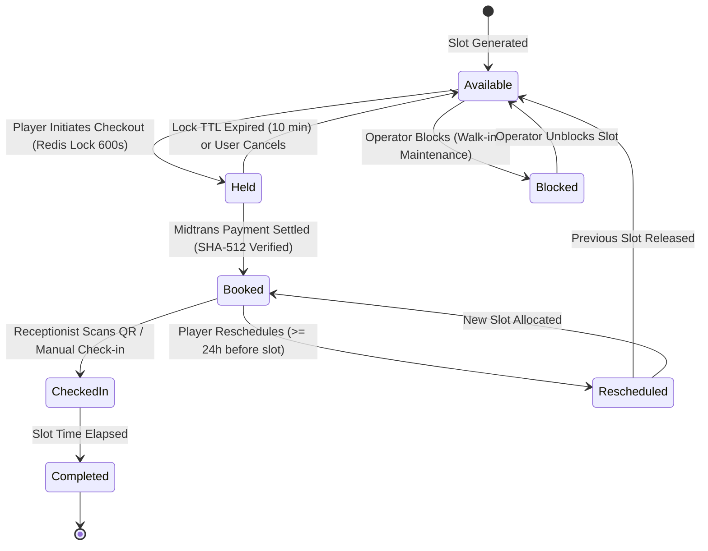
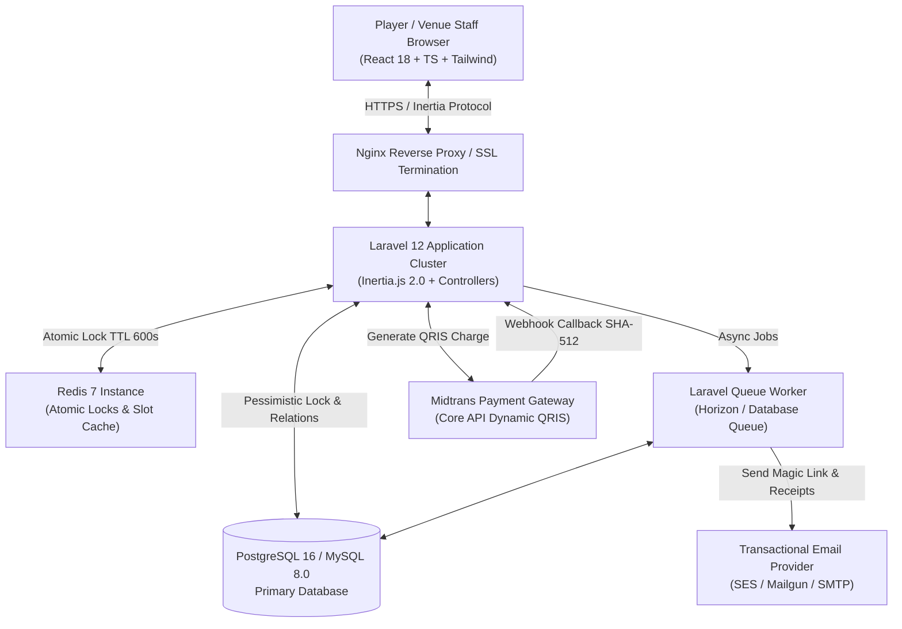
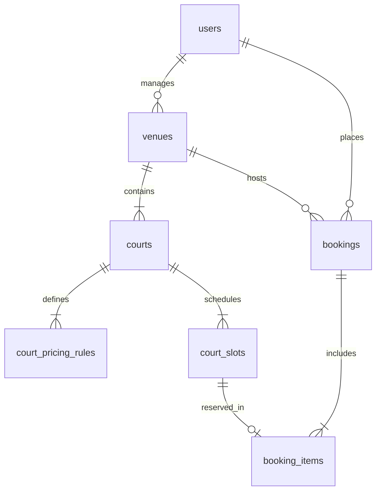
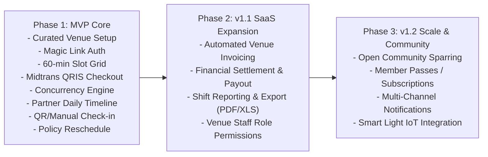

# Product Requirements Document (PRD) — adatempat

> **Document Version:** 2.1.0
> **Status:** Approved for Technical Implementation
> **Product Name:** adatempat
> **Repository Path:** [PRD.md](file:///Users/muhammadachyadirahmat/Developer/adatempat-v2/PRD.md) & [docs/PRD.md](file:///Users/muhammadachyadirahmat/Developer/adatempat-v2/docs/PRD.md)
> **Tech Stack:** Laravel 12.x, Inertia.js 2.0 (React 18 + TypeScript), Tailwind CSS, Redis 7, PostgreSQL 16 (or MySQL 8.0+), Midtrans Core API (Dynamic QRIS)
> **Design Language:** adatempat Two-Tone Athletic Editorial System (`#0145F2` Electric Blue, `#EDF1F5` Soft Canvas, Barlow Condensed, Plus Jakarta Sans)

---

## 1. Executive Summary

### 1.1 Problem Statement

Urban sports players in Indonesia face severe friction when booking sports venues due to opaque scheduling, slow manual chat negotiations (e.g., WhatsApp), and high double-booking rates. Concurrently, sports facility operators lack a unified operational tool to reconcile real-time online reservations with walk-in customers, frequently suffer financial losses from customer no-shows, and are deterred by burdensome transactional commission models.

### 1.2 Proposed Solution

**adatempat** is a curated sports venue marketplace and B2B SaaS management platform. For players, it delivers a frictionless, passwordless booking flow via Email Magic Links, real-time 60-minute slot availability matrices, and single-channel instant checkout via Dynamic QRIS (Midtrans) protected by atomic 10-minute slot locks. For venue managers, adatempat provides an intuitive SaaS Backoffice featuring tiered pricing rules (regular vs. peak-hour, weekday vs. weekend), instant walk-in slot blocking, and flexible attendance verification (manual one-click and camera QR scanning) under a flat subscription business model.

### 1.3 Success Criteria & Measurable KPIs

1. **Zero Double-Booking Incidents (0.00%)**: Absolute prevention of scheduling overlaps achieved via two-tier locking: Redis Atomic Lock (TTL 600s) during checkout holding, followed by PostgreSQL/MySQL Pessimistic Locking (`SELECT ... FOR UPDATE`) upon payment settlement commit.
2. **Checkout Conversion Speed < 60 Seconds**: Authenticated players can select desired court slots, lock availability, and display the payable Dynamic QRIS code in under 60 seconds.
3. **Payment Reconciliation Webhook Latency <= 3 Seconds**: Inbound Midtrans QRIS payment webhooks are verified via SHA-512 signatures, transition booking status from `pending` to `paid`, and emit real-time client state updates in <= 3 seconds.
4. **Reschedule Policy Enforcement 100%**: Zero revenue leakage or booking conflicts through automated enforcement of venue reschedule rules (minimum H-1 / 24-hour advance notice, equivalent pricing tier constraint, strict zero-cash-refund policy).
5. **System Latency & Throughput**: Page navigation via Inertia.js < 150ms; daily slot availability query response time < 80ms under 1,000 concurrent requests.

---

## 2. User Experience & Functionality

### 2.1 User Personas

| Persona                            | Role                                      | Core Goals                                                                                              | Pain Points & Constraints                                                                      |
| ---------------------------------- | ----------------------------------------- | ------------------------------------------------------------------------------------------------------- | ---------------------------------------------------------------------------------------------- |
| **Player (Customer)**              | End-user booking sports courts            | Discover curated venues, view real-time vacant slots, pay instantly via QRIS, access digital entry pass | Rejects password management & SMS/WA OTP friction; needs reliable schedule guarantee           |
| **Venue Operator (Owner / Staff)** | Facility owner or front-desk receptionist | Configure court schedules & tiered pricing, block slots for walk-in players, validate player arrival    | Demands fast cash-register interface; cannot afford complicated training or booking collisions |
| **Platform Superadmin**            | adatempat operations & curation team      | Verify & onboard partner venues, manage SaaS subscription lifecycles, curate master sports & city data  | Requires strict tenant isolation and full auditability of venue subscription statuses          |

---

### 2.2 Booking & Slot State Machine



#### State Transition Matrix

| Current State | Target State  | Trigger Event              | Mechanism / Actor                  | Pre-conditions                                 |
| ------------- | ------------- | -------------------------- | ---------------------------------- | ---------------------------------------------- |
| `available`   | `held`        | Checkout Initiated         | Redis Atomic Lock (TTL 600s)       | Slot status is `available` & unheld            |
| `held`        | `available`   | Checkout Expired / Aborted | Redis Lock Expiry / Worker Cleanup | Payment not confirmed within 10 minutes        |
| `held`        | `booked`      | Payment Webhook Received   | DB Transaction + `lockForUpdate()` | Midtrans transaction status `settlement`       |
| `available`   | `blocked`     | Walk-in / Maintenance      | Venue Operator Backoffice          | Slot status is `available`                     |
| `blocked`     | `available`   | Operator Releases Slot     | Venue Operator Backoffice          | Slot status is `blocked`                       |
| `booked`      | `checked_in`  | Player Arrival Verified    | Camera QR Scan or One-click UI     | Booking is `paid` & check-in unclaimed         |
| `booked`      | `rescheduled` | Reschedule Executed        | Player Self-Service Action         | `allow_reschedule = true`, >= 24h, equal price |

---

### 2.3 User Stories & Acceptance Criteria

#### A. Player Authentication (Passwordless Magic Link)

##### Story 1: Passwordless Login via Email Magic Link

> **As a** Sports Player,
> **I want to** authenticate simply by entering my email address and clicking a secure verification link,
> **So that** I can complete bookings without remembering passwords or dealing with third-party SMS/WhatsApp OTP issues.

**Acceptance Criteria:**

- **Input & Validation**: Login form contains exactly one input: RFC 5322 compliant `email`.
- **Token Generation**: System creates a cryptographically secure, signed URL (`URL::temporarySignedRoute`) with an exact 15-minute expiration timestamp.
- **Single-Use Verification**: Visiting the link verifies the signature, authenticates the Laravel session, immediately invalidates the token against reuse, and redirects to the intended URL (e.g., checkout page).
- **Rate Limiting**: Sending magic links is strictly rate-limited to 5 requests per 15 minutes per IP/email tuple. Client displays a 60-second countdown before enabling the "Resend Link" button.
- **Edge Cases & Error Handling**:
  - _Expired Link_: Displays friendly error with an instant "Request New Login Link" action.
  - _Invalid/Altered Signature_: Returns HTTP 403 Forbidden with security alert log.
  - _Already Authenticated Session_: Directly redirects to dashboard or intended booking route.

---

#### B. Marketplace Discovery & Slot Reservation

##### Story 2: Curated Venue Search & Multi-Sport Filtering

> **As a** Sports Player,
> **I want to** filter curated venues by sport category (Badminton, Padel, Futsal, Tennis, Mini Soccer) and city,
> **So that** I can rapidly locate relevant courts in my area.

**Acceptance Criteria:**

- **Dynamic Filtering**: Supports instant filtering by sports type slug and city slug without full page reloads via Inertia.js partial reload.
- **Venue Card Anatomy**: Displays hero image, venue name (Barlow Condensed 800), verified badge, address/district, "Starting from IDR X/hour" badge, and sports icons.
- **Performance**: Search query response latency < 100ms across datasets of up to 10,000 venue records.

---

##### Story 3: 60-Minute Real-Time Slot Matrix

> **As a** Sports Player,
> **I want to** inspect a date picker and a 60-minute interval slot matrix per court,
> **So that** I can select one or multiple consecutive available playing hours with clear pricing.

**Acceptance Criteria:**

- **Slot Granularity**: Fixed 60-minute intervals (e.g., 07:00-08:00, 08:00-09:00, ..., 22:00-23:00). Half-hour offsets are strictly prohibited.
- **Visual State Indicators**:
  - `Available`: Interactive button displaying the calculated slot price.
  - `Held`: Non-clickable, labeled "In Checkout" with warning styling.
  - `Booked`: Non-clickable disabled badge ("Booked").
  - `Blocked`: Non-clickable disabled badge ("Unavailable").
- **Multi-Slot Selection**: Players can select multiple continuous slots on the same court and date.
- **Dynamic Price Calculation**: Total cart value updates in real time, automatically distinguishing regular vs. peak-hour pricing based on venue rules.

---

##### Story 4: 10-Minute Atomic Hold & Midtrans Dynamic QRIS Payment

> **As an** Authenticated Player,
> **I want to** lock my selected slots for 10 minutes and pay via a dynamic QRIS code,
> **So that** other players cannot purchase my slots while I complete payment in my banking or e-wallet app.

**Acceptance Criteria:**

- **Atomic Lock Initiation**: Clicking "Proceed to Payment" invokes `Cache::lock("court_slot:lock:{$id}", 600)`. If any chosen slot is already locked or booked, the transaction aborts with HTTP 409 Conflict.
- **Order Creation**: Creates a `bookings` record with `payment_status = 'pending'` and corresponding `booking_items`.
- **Dynamic QRIS Generation**: System calls Midtrans Core API `/v2/charge` (`payment_type: "qris"`), stores `qr_string`, and renders a responsive QR Code alongside an active 10-minute countdown timer.
- **Lock Expiration**: If the 10-minute timer expires without confirmed payment, the Redis lock releases automatically, booking status transitions to `expired`, and slots return to `available`.
- **Settlement Handling**: Upon receiving a valid Midtrans webhook (`transaction_status: "settlement"`):
  - Database pessimistic lock (`SELECT ... FOR UPDATE`) guarantees race-condition-free transition of slots to `booked` and booking to `paid`.
  - The player's checkout browser view transitions automatically to the Digital Ticket page.
- **Edge Cases & Error Handling**:
  - _Concurrent Lock Contention_: Player B receives an immediate alert: _"One or more selected slots were just locked by another customer. Please select another slot."_
  - _Midtrans Webhook Delay_: Player page provides a manual "Check Payment Status" button querying Midtrans `/v2/{order_id}/status` directly.

---

##### Story 5: Digital Ticket & Confirmation Receipt

> **As a** Sports Player,
> **I want to** view my digital booking ticket containing an entry QR code and receive an email receipt,
> **So that** I have undisputed proof of booking upon arriving at the sports venue.

**Acceptance Criteria:**

- **Ticket Contents**:
  - Unique Booking Reference Code (e.g., `ADT-20261109-8821`).
  - High-contrast unique QR verification token (`qr_token`).
  - Venue name, court name, booked date, and time range.
  - Real-time status badge: `Paid / Confirmed`, `Checked-In`, `Completed`, or `Rescheduled`.
- **Email Receipt**: Dispatches an HTML transactional email containing order breakdown and a direct link to the web ticket view.

---

##### Story 6: Configurable Player Self-Service Reschedule

> **As a** Sports Player,
> **I want to** reschedule my booking to a future open slot if the venue allows it,
> **So that** I do not forfeit my booking if my group encounters unexpected schedule conflicts.

**Acceptance Criteria:**

- **Venue Permission Gate**: Reschedule action is visible only if venue setting `allow_reschedule === true`.
- **Time Restriction (H-1 Cutoff)**: Player can only reschedule if the request is submitted at least **24 hours prior** to the slot's scheduled start time.
- **Price Parity Requirement**: The replacement slot must belong to an identical pricing tier (same court or equivalent price). Price downgrades do not trigger refunds; price upgrades are prohibited in MVP.
- **Atomic Swap**: System executes an atomic database transaction releasing previous slots to `available` and claiming new slots as `booked`.
- **Strict No Cash Refund**: Cash or balance refund requests are rejected; reschedule is the sole remedy.

---

#### C. Venue Operator SaaS Backoffice

##### Story 7: Court Configuration & Tiered Pricing Matrix

> **As a** Venue Manager,
> **I want to** configure courts and flexible pricing rules (Weekday vs. Weekend, Regular vs. Peak-Hour),
> **So that** all online and offline slot rates are calculated automatically without manual pricing errors.

**Acceptance Criteria:**

- **Court Hierarchy**: Manager can register multiple courts under their assigned venue with designated sport categories.
- **Pricing Matrix Interface**:
  - Day classification: Weekday (Monday–Friday) vs. Weekend (Saturday–Sunday).
  - Time ranges: Configurable start/end hours (e.g., Regular 07:00–17:00, Peak 17:00–23:00).
  - Hourly rate definition in IDR.
- **Immediate Propagation**: Newly published pricing rules apply instantly to all generated unbooked future slots.

---

##### Story 8: Daily Visual Timeline Calendar & Walk-in Slot Blocking

> **As a** Venue Receptionist,
> **I want to** monitor a daily timeline calendar across all courts and block slots for walk-in players,
> **So that** online marketplace availability matches on-ground operations in real time.

**Acceptance Criteria:**

- **Timeline Grid View**: Columns represent courts; rows represent 60-minute time intervals across operational hours.
- **Distinct Color Encoding**:
  - _Electric Blue (`#0145F2`)_: Online adatempat booking (shows customer name & booking code).
  - _Orange / Slate_: Blocked for walk-in or court maintenance (shows reason/note).
  - _Clean Canvas_: Open slot available for online reservation.
- **One-Click Walk-in Blocking**: Clicking an open slot opens a modal to block it with an optional note (e.g., _"Walk-in Cash - Team Garuda"_). Blocked slots are instantly withheld from marketplace search.
- **Unblocking**: Operator can unblock non-booked slots, returning them to marketplace availability.

---

##### Story 9: Flexible Player Attendance Check-in (Manual & Camera QR Scan)

> **As a** Venue Receptionist,
> **I want to** check in arriving players either via one-click manual confirmation or by scanning their ticket QR code using my device camera,
> **So that** front-desk verification is lightning fast and prevents fraudulent double-entry.

**Acceptance Criteria:**

- **Manual Verification**: Receptionist can click any confirmed booking on the daily calendar and trigger `Confirm Check-In`.
- **Camera QR Scanner**: Backoffice provides a dedicated modal utilizing the device's web camera to scan player ticket QR codes.
- **Validation Logic**: System decodes `qr_token`, validates booking state, marks `check_in_status = 'checked_in'`, records `checked_in_at = NOW()`, and displays an audio-visual success indicator.
- **Double-Check Prevention**: Scanning an already checked-in ticket displays an amber warning showing the exact initial check-in timestamp.

---

##### Story 10: Venue Reschedule Policy Control

> **As a** Venue Owner,
> **I want to** toggle whether self-service rescheduling is permitted for my facility,
> **So that** I maintain absolute control over my court cancellation and rescheduling policies.

**Acceptance Criteria:**

- Settings page provides a master toggle: `Allow Customer Rescheduling (24h Advance Notice Required)`.
- Default setting is `false` (Disabled). Toggling immediately enables or disables the customer-facing reschedule action.

---

#### D. Platform Superadmin Portal

##### Story 11: Curated Venue Verification & Subscription Management

> **As an** adatempat Superadmin,
> **I want to** inspect and approve new venue partners and manage their SaaS subscription statuses,
> **So that** only high-quality, paying or trialing venues appear in the public marketplace.

**Acceptance Criteria:**

- **Venue Onboarding**: Superadmin can create venue profiles, upload hero imagery, configure coordinates, and assign owner credentials.
- **Subscription Lifecycle**: Superadmin manages status: `trial`, `active`, `suspended`, or `expired`, along with `subscription_expires_at`.
- **Marketplace Enforcement**: Venues marked `suspended` or `expired` are excluded from marketplace queries, and their open slots cannot be reserved.
- **Master Data Control**: Superadmin maintains master taxonomy of approved sports categories and Indonesian cities/districts.

---

### 2.4 Explicit Non-Goals (Out of Scope for MVP)

1. **Open Self-Service Venue Registration**: Operators cannot register and go live without explicit review and approval by adatempat operations.
2. **Multi-Payment Method Support**: Payment channels other than **Dynamic QRIS** (Credit Cards, Virtual Accounts, Paylater, E-Wallets deep links) are omitted in MVP to simplify reconciliation and eliminate payment disputes.
3. **Automated In-App Subscription Billing**: Monthly SaaS subscription invoicing for venue owners is managed offline/manually by the adatempat sales team during MVP.
4. **WhatsApp Business API Gateway**: No third-party paid WhatsApp messaging (Fonnte/Wablas) for MVP. Notifications rely strictly on the Web App and Transactional Email.
5. **Cash Refunds**: Platform does not process cash or bank refund payouts for cancellations.
6. **Dynamic Surge Pricing & AI Matchmaking**: Machine learning algorithms and surge pricing models are deferred until historical transaction volume matures (Phase 3).

---

## 3. AI System Requirements

> **Status: N/A for MVP Scope**

For the MVP 1.0 release, all system logic is deterministic. AI capabilities (occupancy forecasting, demand-based surge recommendations, and player matchmaking) are scheduled for **Version 2.0+**, triggered when a minimum threshold of 6 months of booking data and 50,000 completed reservations is reached.

---

## 4. Technical Specifications

### 4.1 System Architecture



---

### 4.2 Database Schema Specifications

#### Entity Relationship Overview



#### Detailed Table Definitions

```sql
-- 1. Users Table
CREATE TABLE users (
    id BIGSERIAL PRIMARY KEY,
    name VARCHAR(255) NOT NULL,
    email VARCHAR(255) UNIQUE NOT NULL,
    role VARCHAR(50) NOT NULL DEFAULT 'player', -- 'player', 'venue_owner', 'superadmin'
    venue_id BIGINT NULL REFERENCES venues(id) ON DELETE SET NULL,
    remember_token VARCHAR(100) NULL,
    created_at TIMESTAMP WITH TIME ZONE DEFAULT NOW(),
    updated_at TIMESTAMP WITH TIME ZONE DEFAULT NOW()
);
CREATE INDEX idx_users_email ON users(email);
CREATE INDEX idx_users_role ON users(role);

-- 2. Venues Table
CREATE TABLE venues (
    id BIGSERIAL PRIMARY KEY,
    name VARCHAR(255) NOT NULL,
    slug VARCHAR(255) UNIQUE NOT NULL,
    city VARCHAR(100) NOT NULL,
    address TEXT NOT NULL,
    latitude DECIMAL(10, 7) NULL,
    longitude DECIMAL(10, 7) NULL,
    phone_number VARCHAR(50) NOT NULL,
    allow_reschedule BOOLEAN NOT NULL DEFAULT FALSE,
    subscription_status VARCHAR(50) NOT NULL DEFAULT 'trial', -- 'trial', 'active', 'suspended', 'expired'
    subscription_expires_at TIMESTAMP WITH TIME ZONE NULL,
    is_active BOOLEAN NOT NULL DEFAULT TRUE,
    created_at TIMESTAMP WITH TIME ZONE DEFAULT NOW(),
    updated_at TIMESTAMP WITH TIME ZONE DEFAULT NOW()
);
CREATE INDEX idx_venues_city ON venues(city);
CREATE INDEX idx_venues_slug ON venues(slug);
CREATE INDEX idx_venues_active_sub ON venues(is_active, subscription_status);

-- 3. Courts Table
CREATE TABLE courts (
    id BIGSERIAL PRIMARY KEY,
    venue_id BIGINT NOT NULL REFERENCES venues(id) ON DELETE CASCADE,
    sport_type VARCHAR(50) NOT NULL, -- 'badminton', 'padel', 'futsal', 'tennis', 'mini_soccer'
    name VARCHAR(255) NOT NULL,       -- e.g., 'Court 1 - Vinyl Premium'
    is_active BOOLEAN NOT NULL DEFAULT TRUE,
    created_at TIMESTAMP WITH TIME ZONE DEFAULT NOW(),
    updated_at TIMESTAMP WITH TIME ZONE DEFAULT NOW()
);
CREATE INDEX idx_courts_venue_sport ON courts(venue_id, sport_type);

-- 4. Court Pricing Rules Table
CREATE TABLE court_pricing_rules (
    id BIGSERIAL PRIMARY KEY,
    court_id BIGINT NOT NULL REFERENCES courts(id) ON DELETE CASCADE,
    day_type VARCHAR(20) NOT NULL, -- 'weekday', 'weekend'
    start_time TIME NOT NULL,      -- e.g., '07:00:00'
    end_time TIME NOT NULL,        -- e.g., '17:00:00'
    price_per_hour DECIMAL(12, 2) NOT NULL,
    tier_name VARCHAR(100) NOT NULL, -- 'Regular Morning', 'Peak Evening'
    created_at TIMESTAMP WITH TIME ZONE DEFAULT NOW(),
    updated_at TIMESTAMP WITH TIME ZONE DEFAULT NOW()
);
CREATE INDEX idx_pricing_lookup ON court_pricing_rules(court_id, day_type, start_time, end_time);

-- 5. Court Slots Table
CREATE TABLE court_slots (
    id BIGSERIAL PRIMARY KEY,
    court_id BIGINT NOT NULL REFERENCES courts(id) ON DELETE CASCADE,
    date DATE NOT NULL,
    start_time TIME NOT NULL, -- e.g., '19:00:00'
    end_time TIME NOT NULL,   -- e.g., '20:00:00'
    price DECIMAL(12, 2) NOT NULL,
    status VARCHAR(50) NOT NULL DEFAULT 'available', -- 'available', 'held', 'booked', 'blocked'
    locked_until TIMESTAMP WITH TIME ZONE NULL,
    block_reason VARCHAR(255) NULL,
    created_at TIMESTAMP WITH TIME ZONE DEFAULT NOW(),
    updated_at TIMESTAMP WITH TIME ZONE DEFAULT NOW(),
    CONSTRAINT uq_court_slot UNIQUE (court_id, date, start_time)
);
CREATE INDEX idx_slots_court_date_status ON court_slots(court_id, date, status);

-- 6. Bookings Table
CREATE TABLE bookings (
    id BIGSERIAL PRIMARY KEY,
    booking_code VARCHAR(50) UNIQUE NOT NULL, -- e.g., 'ADT-20261109-8821'
    user_id BIGINT NOT NULL REFERENCES users(id) ON DELETE RESTRICT,
    venue_id BIGINT NOT NULL REFERENCES venues(id) ON DELETE RESTRICT,
    total_amount DECIMAL(12, 2) NOT NULL,
    payment_status VARCHAR(50) NOT NULL DEFAULT 'pending', -- 'pending', 'paid', 'expired', 'rescheduled'
    check_in_status VARCHAR(50) NOT NULL DEFAULT 'unclaimed', -- 'unclaimed', 'checked_in'
    qr_token VARCHAR(64) UNIQUE NOT NULL,
    midtrans_transaction_id VARCHAR(100) NULL,
    qris_url TEXT NULL,
    qris_expires_at TIMESTAMP WITH TIME ZONE NULL,
    paid_at TIMESTAMP WITH TIME ZONE NULL,
    checked_in_at TIMESTAMP WITH TIME ZONE NULL,
    created_at TIMESTAMP WITH TIME ZONE DEFAULT NOW(),
    updated_at TIMESTAMP WITH TIME ZONE DEFAULT NOW()
);
CREATE INDEX idx_bookings_code ON bookings(booking_code);
CREATE INDEX idx_bookings_user ON bookings(user_id);
CREATE INDEX idx_bookings_venue ON bookings(venue_id);
CREATE INDEX idx_bookings_status ON bookings(payment_status, check_in_status);

-- 7. Booking Items Table
CREATE TABLE booking_items (
    id BIGSERIAL PRIMARY KEY,
    booking_id BIGINT NOT NULL REFERENCES bookings(id) ON DELETE CASCADE,
    court_slot_id BIGINT UNIQUE NOT NULL REFERENCES court_slots(id) ON DELETE RESTRICT,
    price DECIMAL(12, 2) NOT NULL,
    created_at TIMESTAMP WITH TIME ZONE DEFAULT NOW(),
    updated_at TIMESTAMP WITH TIME ZONE DEFAULT NOW()
);
CREATE INDEX idx_booking_items_booking ON booking_items(booking_id);
```

---

### 4.3 Integration Points & API Contracts

#### 1. Authentication Endpoints

- `POST /auth/magic-link`: Request magic link email.
  - Payload: `{ "email": "user@example.com" }`
  - Response: `{ "status": "success", "message": "Magic link sent to your inbox." }`
- `GET /auth/magic-link/verify/{token}`: Authenticates session and redirects to intended page.

#### 2. Checkout & Booking Endpoints

- `POST /checkout/hold`:
  - Request Payload:
    ```json
    {
      "court_id": 12,
      "date": "2026-11-15",
      "slot_ids": [101, 102]
    }
    ```
  - Response Payload:
    ```json
    {
      "booking_code": "ADT-20261115-3921",
      "total_amount": 300000.0,
      "qr_string": "00020101021226670016ID.CO.MIDTRANS...",
      "expires_at": "2026-11-15T14:45:00Z"
    }
    ```

#### 3. Midtrans Core API Dynamic QRIS Integration

- **Charge Endpoint**: `POST https://api.midtrans.com/v2/charge`
  - Payload:
    ```json
    {
      "payment_type": "qris",
      "transaction_details": {
        "order_id": "ADT-20261115-3921",
        "gross_amount": 300000
      },
      "qris": {
        "acquirer": "gopay"
      }
    }
    ```
- **Webhook Callback Endpoint**: `POST /api/webhooks/midtrans`
  - **Signature Hash Validation**:
    $$\text{Signature} = \text{SHA512}(\text{order\_id} + \text{status\_code} + \text{gross\_amount} + \text{ServerKey})$$
  - **Idempotency Rule**: If `bookings.payment_status === 'paid'`, ignore duplicate callback and respond immediately with HTTP 200.

---

### 4.4 Concurrency & Security Safeguards

#### 1. Two-Phase Anti-Double-Booking Locking Algorithm

```php
namespace App\Services;

use App\Models\Booking;
use App\Models\CourtSlot;
use Illuminate\Support\Facades\Cache;
use Illuminate\Support\Facades\DB;
use App\Exceptions\SlotUnavailableException;

class BookingConcurrencyService
{
    /**
     * Phase 1: Temporary Checkout Hold (Redis Atomic Lock, TTL 600s)
     */
    public function acquireHoldLocks(array $slotIds): void
    {
        foreach ($slotIds as $slotId) {
            $lockKey = "court_slot:lock:{$slotId}";
            $lock = Cache::lock($lockKey, 600); // 10 minutes

            if (!$lock->get()) {
                // Release previously acquired locks if any fail
                $this->releaseHoldLocks(array_slice($slotIds, 0, array_search($slotId, $slotIds)));
                throw new SlotUnavailableException("One or more slots are currently held by another player.");
            }
        }
    }

    /**
     * Phase 2: Pessimistic Settlement Commit (Database Transaction)
     */
    public function commitBookingPayment(Booking $booking): void
    {
        DB::transaction(function () use ($booking) {
            // Lock slot rows against concurrent updates
            $slots = CourtSlot::whereIn('id', $booking->items->pluck('court_slot_id'))
                ->lockForUpdate()
                ->get();

            foreach ($slots as $slot) {
                if ($slot->status === 'booked') {
                    throw new SlotUnavailableException("Slot {$slot->id} is already booked.");
                }
                $slot->update(['status' => 'booked']);
            }

            $booking->update([
                'payment_status' => 'paid',
                'paid_at' => now(),
            ]);
        });

        // Release temporary Redis locks after DB commit
        $this->releaseHoldLocks($booking->items->pluck('court_slot_id')->toArray());
    }

    public function releaseHoldLocks(array $slotIds): void
    {
        foreach ($slotIds as $slotId) {
            Cache::lock("court_slot:lock:{$slotId}")->forceRelease();
        }
    }
}
```

#### 2. Security Safeguards

- **Tenant Scoping**: All Venue Partner queries must be strictly scoped by authenticated user's `venue_id` via a global scope or controller authorization policy.
- **Signed URL Expiration**: Magic link tokens are signed via HMAC SHA-256 and strictly invalidated after initial consumption.
- **Throttling**: Endpoint rate limits configured at 5 requests/min for login initiation and 10 requests/min for checkout creation.

---

## 5. Risks & Phased Implementation Roadmap

### 5.1 Phased Implementation Roadmap



#### Phase 1: MVP Core (Current Target)

- Database schema migrations and Eloquent models with strict typing.
- Custom Passwordless Magic Link Email authentication.
- Venue explorer and 60-minute interval slot matrix view (Inertia.js + React).
- Two-phase locking engine (Redis atomic lock + DB pessimistic transaction).
- Midtrans Core API Dynamic QRIS payment generation and webhook handler.
- Digital ticket presentation with QR token and transactional email receipt.
- Partner dashboard: daily visual timeline calendar, walk-in slot blocking, tiered pricing matrix, and attendance verification (manual + QR camera).
- Reschedule self-service flow (H-1 cutoff, equal pricing tier, non-refundable).
- Platform Superadmin curation panel.

#### Phase 2: v1.1 Operational Expansion

- Automated recurring SaaS invoicing for venue partner subscriptions.
- Payout ledger tracking revenue shares and operator disbursements.
- Shift handover reporting and Excel/PDF booking export for accountants.
- Granular backoffice roles (`owner`, `manager`, `cashier`).

#### Phase 3: v1.2 Scale & Community

- Community matchmaking / open sparring match finder.
- Multi-channel notification delivery (WhatsApp Business API fallback).
- Hardware IoT integration for automated court floodlight switching via QR code check-in.

---

### 5.2 Technical Risks & Mitigation Matrix

| Risk Event                                   | Severity | Likelihood | Mitigation Strategy                                                                                                                                        |
| -------------------------------------------- | -------- | ---------- | ---------------------------------------------------------------------------------------------------------------------------------------------------------- |
| **Player Abandons Payment Mid-Checkout**     | Medium   | High       | Redis Lock expires strictly at 600s; an automated background worker cleans expired `pending` bookings and resets slot state to `available`.                |
| **Transactional Email Marked as Spam**       | High     | Medium     | Enforce strict SPF, DKIM, and DMARC DNS records; provide 60-second rate-limited resend option in the UI.                                                   |
| **Front-desk Device Camera Inaccessible**    | Low      | Medium     | Provide instant one-click manual check-in button directly on each booking row in the timeline calendar.                                                    |
| **Midtrans Webhook Delayed or Dropped**      | High     | Low        | Implement idempotent callback handling; provide synchronous status inquiry (`GET /v2/{order_id}/status`) when the player lands on the pending ticket view. |
| **Database Race Condition on Flash Booking** | Critical | Low        | Two-tier locking: Redis lock prevents checkout collisions; `SELECT ... FOR UPDATE` inside DB transactions provides ironclad ACID consistency at commit.    |

---

## 6. Verification & Quality Assurance Strategy

To ensure zero regressions and maintain production standards, development must adhere to the following test suites:

1. **Concurrency Test Suite**:
   - Simulated concurrent checkout requests on the same slot must yield exactly 1 HTTP 201/200 success and $N-1$ HTTP 409 Conflict responses.
2. **Webhook Integrity Suite**:
   - Webhook test sending forged SHA-512 signatures must be rejected with HTTP 401 Unauthorized.
   - Valid webhook callbacks must be idempotent: duplicate payloads must return HTTP 200 without modifying state.
3. **Reschedule Enforcement Suite**:
   - Reschedule attempts with $< 24$ hours remaining must be rejected.
   - Reschedule attempts to higher or lower-priced slots must be rejected in MVP.
4. **End-to-End Flow Test**:
   - Magic link login $\rightarrow$ slot selection $\rightarrow$ QRIS generation $\rightarrow$ mock webhook settlement $\rightarrow$ digital ticket verification $\rightarrow$ receptionist QR check-in.
