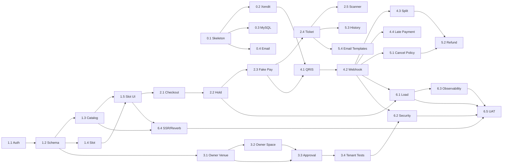

# Implementation Plan — AdaTempat MVP

**Status:** Draft untuk eksekusi
**Tanggal:** 4 November 2026
**Referensi:** `adatempat-prd-revised.md`, `review-report.md`
**Scope:** Phase 1 MVP. Phase 2 (POS, staff, reschedule, wallet/payout/escrow, SaaS subscription, WhatsApp, dashboard GMV) tidak termasuk.

---

## Aturan Checkpoint (Wajib)

Dokumen ini adalah **sumber utama checkpoint**. Setiap kali satu chunk/tahap selesai, sebelum berhenti:

1. Ubah baris chunk di **tabel progress §18** ke status yang benar (`DONE`/`BLOCKED`/`REVIEW`/`IN PROGRESS`).
2. Tambah **satu baris checkpoint log §18**: tanggal, chunk, status, bukti verifikasi, blocker, next.
3. Jangan tandai `DONE` sebelum acceptance criteria dan bukti lulus (test/build/cek manual).
4. Sinkronkan `PROGRESS.md` sebagai mirror kronologis.
5. **Berhenti dan tunggu konfirmasi user** sebelum memulai tahap berikutnya.

Checkpoint tanpa bukti dianggap belum selesai. Jika menunggu dependency eksternal, gunakan `BLOCKED` dan tulis blocker konkretnya.

---

## 1. Tujuan & Cara Pakai

Dokumen ini memecah Sprint 0–6 menjadi **31 chunk** yang masing-masing:

- Berukuran **1–3 hari kerja**.
- Berupa **vertical slice** yang bisa didemokan/diuji.
- Punya dependency, acceptance criteria, dan definition of done yang jelas.

Cara pakai:

1. Kerjakan chunk sesuai urutan dependency, bukan urutan angka saja.
2. Update status chunk dan checkpoint log di §18 setiap tahap selesai (lihat **Aturan Checkpoint** di atas).
3. Jangan mulai chunk berikutnya jika acceptance criteria chunk sebelumnya belum lulus.
4. Jika ada perubahan scope, catat di PRD revisi dan review report; jangan diam-diam menambah fitur.
5. Estimasi di dokumen ini adalah **kerja aktif**, bukan kalender. Waktu tunggu Xendit/KYC/UAT dihitung terpisah.

---

## 2. Prinsip Eksekusi

1. **Vertical slice, bukan horizontal layer.** Jangan membuat “semua migration”, lalu “semua controller”, lalu “semua UI”.
2. **Walking skeleton dulu.** Booking → fake payment → tiket → scanner harus jalan end-to-end sebelum Xendit asli.
3. **Risk-first.** Validasi Xendit split/KYC/refund dan concurrency MySQL di Sprint 0.
4. **Gate-driven.** Jangan lanjut ke fase berikutnya jika gate belum lulus.
5. **Phase 2 tidak disentuh.** Tidak ada tabel/route POS, wallet, SaaS, WhatsApp, atau reschedule di migrasi MVP.
6. **Contract-first.** Route name, props Inertia, enum status, dan bentuk JSON disepakati sebelum frontend/backend paralel.
7. **Setiap chunk selesai dengan test + demo.** Tidak ada “selesai” tanpa bukti.
8. **PR kecil, merge harian.** Hindari branch panjang dan konflik besar.

---

## 3. Asumsi & Prasyarat

### 3.1 Teknis

- Laravel 13, PHP 8.3–8.5.
- React 19 + TypeScript + Inertia.js + Tailwind CSS v4.
- MySQL 8.
- Redis 8.
- Xendit sandbox/production credentials.
- Email provider transaksional (dipilih di Sprint 0).
- Storage privat untuk cover/bukti refund.
- GitHub Actions atau CI setara.

### 3.2 Produk

- 4 venue seed untuk development/UAT.
- Owner portal minimal dan approval superadmin masuk MVP.
- Checkout online wajib login.
- Horizon booking 30 hari.
- Tidak ada fee konsumen, komisi, atau escrow di MVP.
- Email adalah kanal notifikasi MVP; WhatsApp Phase 2.

### 3.3 Eksternal

- Xendit split settlement/sub-account dan KYC venue harus dikonfirmasi di Sprint 0.
- Refund pada transaksi split settlement harus dikonfirmasi sebelum Sprint 5.
- Legal PJP, UU PDP, dan pajak perlu review paralel; tidak memblokir coding, tetapi memblokir launch jika belum selesai.

---

## 4. Definition of Done per Chunk

Sebuah chunk dianggap selesai jika:

- [ ] Migration/model (jika ada) dan factory/seed diperbarui.
- [ ] Route/controller/service/policy (jika ada) terimplementasi.
- [ ] UI Inertia (jika ada) berfungsi dan responsive.
- [ ] Unit/feature test relevan lulus.
- [ ] Test konkurensi/kontrak (jika relevan) lulus.
- [ ] CI hijau: Pint, Larastan, Pest/PHPUnit, `npm run build`.
- [ ] Tidak ada secret di repo.
- [ ] Demo singkat atau screenshot/video tersedia.
- [ ] Acceptance criteria chunk terpenuhi.
- [ ] Tidak menambah fitur Phase 2.

---

## 5. Roadmap & Gate

| Sprint | Fokus                                           | Estimasi aktif | Gate                                                          |
| ------ | ----------------------------------------------- | -------------- | ------------------------------------------------------------- |
| 0      | Verification & skeleton                         | 3–5 hari       | **Gate 0:** Xendit split/KYC/refund viable; concurrency proof |
| 1      | Fondasi + katalog + slot                        | 7–12 hari      | **Gate 1:** publik bisa browse dan lihat slot                 |
| 2      | Booking + hold + fake payment + tiket + scanner | 7–9 hari       | **Gate 2:** end-to-end demo tanpa Xendit                      |
| 3      | Owner portal + approval + superadmin            | 6–8 hari       | **Gate 3:** owner onboarding + approval                       |
| 4      | Xendit QRIS + webhook + split                   | 6–8 hari       | **Gate 4:** real payment + replay-safe                        |
| 5      | Cancellation + refund + history + email         | 6–8 hari       | **Gate 5:** operasional MVP lengkap                           |
| 6      | Hardening + pilot                               | 7–10 hari      | **Gate 6:** pilot-ready                                       |

Total kerja aktif: **42–60 hari** (± 8–12 minggu). Tambahkan buffer 20–30% untuk review, UAT, dan waktu tunggu eksternal → **10–14 minggu kalender** untuk satu developer full-time dengan AI-assisted coding.

---

## 6. Sprint 0 — Verification & Skeleton

| ID  | Chunk                   | Deliverable                                                                | Depends | Estimasi   | Acceptance                                                                                     |
| --- | ----------------------- | -------------------------------------------------------------------------- | ------- | ---------- | ---------------------------------------------------------------------------------------------- |
| 0.1 | Skeleton repo           | Laravel 13 + Inertia React TS + Tailwind + MySQL/Redis + CI + health check | —       | 0,5–1 hari | `php artisan test`, `npm run build`, dan CI hijau; `.env.example` lengkap                      |
| 0.2 | Xendit spike            | QRIS create, webhook auth, split/KYC, refund API; decision memo            | 0.1     | 1–2 hari   | QRIS sandbox berhasil; webhook terverifikasi; status split/KYC/refund terdokumentasi; go/no-go |
| 0.3 | MySQL concurrency spike | Canonical grid + unique cell + row lock; uji 2 proses paralel              | 0.1     | 1 hari     | Dua request paralel: satu sukses, satu conflict; overlap test lulus                            |
| 0.4 | Email spike             | Provider transaksional, kirim email dummy, SPF/DKIM/DMARC                  | 0.1     | 0,5 hari   | Email diterima; konfigurasi domain dan fallback log terdokumentasi                             |

### Gate 0

- [ ] Xendit QRIS bisa dibuat di sandbox.
- [ ] Webhook auth dan replay test berhasil.
- [ ] Split settlement/sub-account dan KYC venue jelas.
- [ ] Refund pada split settlement jelas.
- [x] Concurrency MySQL terbukti (chunk 0.3; lihat `docs/mysql-concurrency-spike.md`).
- [ ] Email provider siap (pipeline lokal + Mailpit lulus; provider/domain live pending).
- [ ] Keputusan go/no-go dan fallback dicatat.

**Stop rule:** jika split settlement tidak viable, jangan lanjut Sprint 4 dengan asumsi. Pilih fallback QRIS langsung + konfirmasi manual (pilot) atau tunda payment online.

---

## 7. Sprint 1 — Fondasi + Katalog + Slot

| ID  | Chunk                 | Deliverable                                                                         | Depends  | Estimasi | Acceptance                                                                                  |
| --- | --------------------- | ----------------------------------------------------------------------------------- | -------- | -------- | ------------------------------------------------------------------------------------------- |
| 1.1 | Auth & RBAC           | Login/register, business registration, role, policy, tenant scope                   | 0.1      | 1–2 hari | Customer/owner/superadmin bisa login; owner hanya melihat business sendiri; test IDOR dasar |
| 1.2 | Schema katalog + seed | Business, venue, space, schedule, amenity, add-on; factory + 4 seed venue           | 1.1      | 1–2 hari | `migrate:fresh --seed` menghasilkan 4 venue dengan space/schedule                           |
| 1.3 | Public catalog UI     | Home, browse, filter kota/kategori/tanggal/harga, venue profile, space detail       | 1.2      | 2–3 hari | Halaman render; filter bekerja; responsive; tidak ada N+1 query                             |
| 1.4 | Slot engine           | `SlotGeneratorService`, canonical grid, horizon 30 hari, timezone, schedule version | 1.2      | 2–3 hari | Unit test durasi 30/60/90/120, horizon 30/31, timezone WITA/WIB, perubahan schedule         |
| 1.5 | Slot UI + cache       | Date selector 7 hari, slot grid, polling/Reverb, cache invalidation                 | 1.3, 1.4 | 1–2 hari | Slot tampil; update setelah booking; cache invalid; fallback polling                        |

### Gate 1

- [ ] Publik bisa browse venue/space.
- [ ] Slot tampil sesuai jadwal, timezone, dan horizon.
- [ ] Booking lama tidak bisa ditimpa perubahan jadwal.
- [ ] Seed data cukup untuk demo.

---

## 8. Sprint 2 — Booking + Hold + Fake Payment + Ticket + Scanner

| ID  | Chunk                       | Deliverable                                                         | Depends | Estimasi | Acceptance                                                                        |
| --- | --------------------------- | ------------------------------------------------------------------- | ------- | -------- | --------------------------------------------------------------------------------- |
| 2.1 | Checkout + booking          | Login required, add-on, total, validasi, booking `pending_payment`  | 1.5     | 2 hari   | Total = slot + add-on; add-on per_hour/per_item/per_booking benar; booking dibuat |
| 2.2 | Hold + cleanup              | Redis lock, MySQL row lock, all-or-nothing, expiry job, conflict UX | 2.1     | 2 hari   | Paralel: satu sukses; expiry 10 menit melepas slot; tidak ada partial booking     |
| 2.3 | Fake payment + payment page | Provider fake lokal, polling status, booking confirmed              | 2.2     | 1 hari   | Fake paid → confirmed; expiry → expired; tidak ada payment asli                   |
| 2.4 | Ticket + email log          | Token 64 karakter, signed URL, ticket page, email log driver        | 2.3     | 1 hari   | Signed URL expired ditolak; token unik; email log queued/sent; `noindex`          |
| 2.5 | Gate scanner                | Kamera, manual input, validasi window/venue/token, `checked_in`     | 2.4     | 1–2 hari | Scan valid → checked_in; reuse/wrong venue/wrong window ditolak                   |

### Gate 2

- [x] End-to-end demo: browse → checkout → fake pay → tiket → scan.
- [x] Konkurensi hold terbukti.
- [x] Tiket single-use.
- [x] Belum ada dependency Xendit.

---

## 9. Sprint 3 — Owner Portal + Approval + Superadmin Minimal

| ID  | Chunk                             | Deliverable                                                         | Depends  | Estimasi | Acceptance                                                                     |
| --- | --------------------------------- | ------------------------------------------------------------------- | -------- | -------- | ------------------------------------------------------------------------------ |
| 3.1 | Owner venue CRUD                  | Create/edit venue, timezone, cover, submit approval, publish toggle | 1.2      | 1–2 hari | Owner hanya melihat venue sendiri; `pending` tidak tampil; cover privat/signed |
| 3.2 | Owner space/schedule/add-on       | CRUD space, cancellation policy, add-on, schedule editor            | 3.1      | 2–3 hari | Validasi harga/slot; schedule tidak overlap; add-on pricing benar              |
| 3.3 | Superadmin approval + audit + 2FA | Queue approval, reject reason, audit log, 2FA                       | 1.1, 3.1 | 2 hari   | Approve → publish; reject → hidden; audit tercatat; 2FA enforced               |
| 3.4 | Tenant isolation tests            | IDOR/RBAC matrix, policy coverage                                   | 3.1–3.3  | 1 hari   | Cross-business ditolak; matrix lulus                                           |

### Gate 3

- [x] Owner bisa onboarding venue/space/schedule.
- [x] Superadmin bisa approve/reject.
- [x] Venue `pending` tidak muncul di marketplace.
- [x] Audit log dan 2FA aktif.

---

## 10. Sprint 4 — Xendit QRIS + Webhook + Split

| ID  | Chunk                             | Deliverable                                                            | Depends  | Estimasi | Acceptance                                                                       |
| --- | --------------------------------- | ---------------------------------------------------------------------- | -------- | -------- | -------------------------------------------------------------------------------- |
| 4.1 | Xendit QRIS create + page         | Invoice, QR render, expiry, polling, amount validation                 | 0.2, 2.3 | 2 hari   | QRIS sandbox tampil; expiry 10 menit; amount cocok                               |
| 4.2 | Webhook + idempotency             | Auth token/signature, event store, replay, queue job, state transition | 4.1      | 2 hari   | Invalid ditolak; duplicate tidak menggandakan; event valid → confirmed           |
| 4.3 | Split settlement + reconciliation | Sub-account/split rule, settlement report, fallback flag               | 4.1      | 1–2 hari | 100% rental ke venue; platform 0; report/reconciliation; fallback terdokumentasi |
| 4.4 | Late payment + expiry             | Expire job, `refund_pending`, no auto-confirm                          | 4.2      | 1 hari   | Paid setelah expiry → `refund_pending`; slot tidak diklaim ulang                 |

### Gate 4

- [ ] Real QRIS payment di sandbox.
- [ ] Webhook replay-safe.
- [ ] Split settlement terverifikasi.
- [ ] Late payment tidak auto-confirm.

---

## 11. Sprint 5 — Cancellation + Refund + History + Email

| ID  | Chunk                       | Deliverable                                                 | Depends  | Estimasi | Acceptance                                               |
| --- | --------------------------- | ----------------------------------------------------------- | -------- | -------- | -------------------------------------------------------- |
| 5.1 | Cancellation policy + quote | Policy snapshot, cutoff, refund percentage, UI quote        | 4.2      | 2 hari   | Free/partial/non-refundable benar; cutoff boundary diuji |
| 5.2 | Refund manual + audit       | Refund queue, proof upload, status, audit, customer view    | 5.1, 4.3 | 2 hari   | Refund tercatat; bukti privat; status customer; audit    |
| 5.3 | Customer history            | Upcoming/past, ticket link, refund status; tanpa reschedule | 2.4      | 1 hari   | Hanya booking sendiri; status benar; tiket signed        |
| 5.4 | Email templates + retry     | Konfirmasi, tiket, refund; queue + retry + log              | 2.4      | 1–2 hari | Template benar; retry maks 3; log; tidak double-send     |

### Gate 5

- [ ] Cancellation/refund manual berfungsi end-to-end.
- [ ] Customer history benar.
- [ ] Email konfirmasi/tiket/refund terkirim.
- [ ] Tidak ada dependency WhatsApp.

---

## 12. Sprint 6 — Hardening + Pilot

| ID  | Chunk                   | Deliverable                                                   | Depends  | Estimasi | Acceptance                                               |
| --- | ----------------------- | ------------------------------------------------------------- | -------- | -------- | -------------------------------------------------------- |
| 6.1 | Concurrency + load test | Parallel test, k6, p95/p99, fix bottleneck                    | 2.2, 4.2 | 2 hari   | 0 double booking; target p95/p99 terpenuhi atau direvisi |
| 6.2 | Security review         | IDOR, rate limit, signed URL, replay, upload, dependency scan | 3.4, 4.2 | 1–2 hari | Checklist lulus; tidak ada high/critical                 |
| 6.3 | Observability + backup  | Log, metric, alert, health check, backup/restore              | 6.1      | 1 hari   | Dashboard/alert aktif; restore test lulus                |
| 6.4 | SSR + Reverb            | SSR public pages, Reverb + polling fallback, cache            | 1.3, 1.5 | 1–2 hari | Meta/JSON-LD; fallback polling; tidak memblokir core     |
| 6.5 | UAT + pilot docs        | 4 venue seed, skenario UAT, runbook, launch checklist         | 6.1–6.4  | 2 hari   | UAT pass; runbook siap; launch checklist lengkap         |

### Gate 6

- [ ] Semua test P0 lulus.
- [ ] Load/security review lulus.
- [ ] UAT 4 venue selesai.
- [ ] Runbook dan backup/restore siap.
- [ ] Launch checklist disetujui.

---

## 13. Dependency Graph

---

## 14. Parallelisasi

### Solo developer

Kerjakan berurutan sesuai sprint dan dependency. Jangan buka dua chunk besar sekaligus.

### Dua developer

**Lane backend**

- 0.2, 0.3
- 1.1, 1.2, 1.4
- 2.1, 2.2
- 4.1–4.4
- 5.1, 5.2

**Lane frontend**

- 1.3, 1.5
- 2.3 (payment UI), 2.4 (ticket page), 2.5
- 3.1, 3.2
- 5.3, 5.4

Aturan:

- Sepakati kontrak route/props/enum sebelum mulai.
- Jangan edit file yang sama bersamaan.
- Merge harian; branch pendek.
- Frontend boleh memakai fake provider selama backend Xendit belum siap.

### AI-assisted

- AI cocok untuk scaffold, CRUD, test, migrasi, refactor, dokumentasi.
- Manusia tetap review arsitektur, keamanan, UX, dan hasil test.
- Ukuran chunk mengikuti kapasitas review, bukan kapasitas generate.

---

## 15. Testing & CI

### Test pyramid

- **Unit:** slot generation, overlap, pricing, state transition, refund math, timezone.
- **Feature:** RBAC/IDOR, approval, checkout, hold expiry, webhook replay, scanner.
- **Concurrency:** beberapa worker/process rebutan slot; pastikan satu booking.
- **Contract:** Xendit sandbox + fake provider untuk CI.
- **E2E:** owner CRUD → approval → browse → checkout → pay → ticket → scan → refund → history.
- **Load:** k6 di Sprint 6; p95/p99, error rate, queue lag.
- **Security:** signed URL, rate limit, replay, upload, dependency scan.

### CI pipeline

1. Install PHP/Node dependencies.
2. Pint.
3. Larastan.
4. Pest/PHPUnit.
5. `npm run build`.
6. Playwright smoke (opsional, staging).
7. Migration check pada database bersih.

### Test data

- Factory deterministik; waktu/timezone eksplisit.
- 4 venue seed; tidak memakai PII produksi.
- Fake Xendit provider untuk CI; sandbox untuk integration.

---

## 16. Environments & Operations

- **Local:** Laravel Sail/Herd, MySQL 8, Redis 8, Mailpit/log email.
- **Staging:** MySQL/Redis terkelola, Xendit sandbox, email sandbox.
- **Production:** MySQL/Redis terkelola, Xendit production, email provider, storage privat.
- **Queue:** Redis; worker `queue:work`.
- **Scheduler:** cleanup hold, no-show, email retry.
- **Observability:** structured log, metric, trace, alert.
- **Backup:** harian; restore test di Sprint 6.
- **Secrets:** env/secret manager; tidak masuk repo.

---

## 17. Risk Register

| Risiko                              | Dampak                              | Trigger       | Mitigasi                                                       | Gate  |
| ----------------------------------- | ----------------------------------- | ------------- | -------------------------------------------------------------- | ----- |
| Split settlement/KYC tidak tersedia | Pembayaran online tidak bisa scale  | Gate 0        | Fallback QRIS langsung + konfirmasi manual; evaluasi ulang     | 0     |
| Refund split settlement tidak jelas | Refund manual tidak bisa dieksekusi | Gate 0/5      | Konfirmasi Xendit refund; transfer venue/platform; dokumentasi | 0, 5  |
| MDR/pajak                           | Unit economics/refund salah         | Gate 5        | Validasi Xendit/konsultan; kebijakan refund MDR                | 5     |
| Legal PJP/escrow                    | Launch tertunda                     | Gate 6        | Review legal; escrow Phase 2                                   | 6     |
| UU PDP                              | Risiko kepatuhan                    | Gate 6        | Consent, retensi, enkripsi, kebijakan privasi                  | 6     |
| Overlap MySQL                       | Double booking                      | Gate 2/6      | Canonical grid, unique cell, row lock, parallel test           | 2, 6  |
| SSR/Reverb                          | Deploy/biaya                        | Gate 6        | Fallback polling; observability; load test                     | 6     |
| Email deliverability                | Tiket tidak sampai                  | Gate 5        | Provider transaksional, SPF/DKIM/DMARC, retry                  | 5     |
| Adopsi venue                        | Marketplace kosong                  | Gate 6        | Seed venue, onboarding playbook, feedback                      | 6     |
| Pendapatan MVP                      | Tidak ada revenue                   | —             | Anggarkan sebagai akuisisi; siapkan SaaS Phase 2               | —     |
| Scope creep                         | MVP tidak selesai                   | Setiap sprint | Change control; Phase 2 backlog terpisah                       | Semua |

---

## 18. Progress Tracking

Status yang dipakai:

- `TODO` — belum mulai.
- `IN PROGRESS` — sedang dikerjakan.
- `BLOCKED` — menunggu dependency/eksternal.
- `REVIEW` — menunggu review/test.
- `DONE` — acceptance criteria lulus.

Tabel progress:

| ID  | Status      | Owner       | Mulai      | Selesai    | Catatan                                                                                                                                                 |
| --- | ----------- | ----------- | ---------- | ---------- | ------------------------------------------------------------------------------------------------------------------------------------------------------- |
| 0.1 | DONE        | AI + review | 2026-11-05 | 2026-11-05 | Laravel 13 + Inertia React TS + Tailwind 4; MySQL `adatempat_v4`; Redis cache/queue/session; CI MySQL+Redis; `/up`; 41 test lulus                       |
| 0.2 | BLOCKED     | AI + review | 2026-11-05 | —          | Kode + 9 test lokal lulus; memo `docs/xendit-spike.md`; verifikasi sandbox live menunggu kredensial Xendit                                              |
| 0.3 | DONE        | AI + review | 2026-11-05 | 2026-11-05 | Canonical grid `slot_locks` + `booking_slots`; unique cell + row lock; `slot:concurrency-check` PASS; memo `docs/mysql-concurrency-spike.md`            |
| 0.4 | BLOCKED     | AI + review | 2026-11-05 | —          | Pipeline lokal + Mailpit + fallback log lulus; provider/domain live menunggu kredensial; memo `docs/email-spike.md`                                     |
| 1.1 | DONE        | AI + review | 2026-11-05 | 2026-11-05 | Role enum, businesses, register/business UI+backend, policy, role middleware, IDOR tests; 67 test/211 assertion; visual QA 390/768/1440                 |
| 1.2 | DONE        | AI + review | 2026-11-05 | 2026-11-05 | 7 migrasi katalog + 6 model + 6 factory + `CatalogSeeder`; `migrate:fresh --seed` = 4 venue/8 space/56 schedule; seed idempotent; 73 test/248 assertion |
| 1.3 | DONE        | AI + review | 2026-11-05 | 2026-11-05 | Public catalog UI selesai (Home, Browse `/spaces` dengan toolbar filter & sort, Venue detail `/v/{venue}`, Space detail `/spaces/{space}`). Rekonstruksi editorial DOKO seimbang 6/6 hero split + grid spesifikasi 2 kolom; zero horizontal overflow di 320/390/768/1024/1440; WCAG 2.2 AA lolos (ink 12.76:1, stone 5.71:1, stone-on-sand 4.61:1, cobalt 5.29:1, disabled button 4.61:1); 81 test Pest / 435 assertions, PHPStan & Pint lolos, `tsc --noEmit` lolos. |
| 1.4 | DONE        | AI + review | 2026-11-05 | 2026-11-05 | `SlotGeneratorService` canonical grid in-memory generator; evaluasi timezone lokal venue (WIB/WITA/WIT), horizon 30 hari (tolak lampau & H+31), transisi versi schedule, potong durasi 30/60/90/120 min tanpa celah, diff database `booking_slots` (booked vs past vs available); 9 test Pest baru / 59 assertions; `composer ci:check` 90 test / 494 assertions hijau, `slot:concurrency-check` PASS |
| 1.5 | DONE        | AI + review | 2026-11-05 | 2026-11-05 | Slot UI + Cache: date selector 7 hari dengan batas horizon 30 hari, slot matrix kanonikal, multi-slot selection, dynamic order summary rail, Redis caching (`slots:space:{id}:date:{date}`, TTL 60s, cache invalidation saat reservasi), fallback background polling 15s; 7 test Pest baru (total 97 test / 537 assertion); visual QA 320/390/768/1024/1440 zero overflow; CI hijau penuh |
| 2.1 | DONE        | AI + review | 2026-11-05 | 2026-11-05 | Checkout & Booking pending payment: Skema DB `bookings` & `booking_add_ons`; Enums `BookingStatus` & `PaymentMethod`; `BookingService` (kalkulasi add-on multi-type: `per_hour`, `per_item`, `per_booking`, transaksi DB atomik, row lock `slot_locks`, cache invalidation, unique code `ADT-BK-YYYYMMDD-XXXXX` & `qr_checkin_token`); `CheckoutController` & `PaymentController`; Frontend `checkout.tsx` & `payment-pending.tsx` (editorial DOKO); 13 test Pest baru / 99 assertions (total 110 test / 636 assertions hijau); browser QA 5 viewport (320, 390, 768, 1024, 1440) zero overflow; WCAG 2.2 AA pass; `composer ci:check` hijau penuh |
| 2.2 | DONE        | AI + review | 2026-11-06 | 2026-11-06 | Hold + cleanup: Redis distributed lock Tier 1 (`Cache::lock`) + MySQL row lock Tier 2 (`slot_locks`), all-or-nothing rollback pada multi-slot, pra-pemeriksaan kueri bentrok, release `booking_slots` & cache invalidation otomatis saat expired, `BookingService::expireBooking` & `expirePendingBookings`, command Artisan `bookings:expire-pending` + scheduled cron `everyMinute()`, queued job `ExpirePendingBookingsJob`, on-the-fly expiry di `PaymentController::show`, `SlotGeneratorService::generate`, & `CheckoutController::store`, flash session error handling di `HandleInertiaRequests`, conflict action banner ("Pilih Slot Waktu Lain" → `/spaces/{slug}?date={date}`) di `checkout.tsx` & alert di `space-slot-picker.tsx`, expired UI state (badge Kedaluwarsa, kartu peringatan habis waktu, CTA "Pesan Ulang Lapangan") di `payment-pending.tsx`; 6 test baru (total 116 test / 670 assertions hijau); `slot:concurrency-check` PASS; browser QA Chromium terverifikasi; `composer ci:check` hijau penuh (Pint, PHPStan Level 5 0 error, Pest 100%, `vp check` 100 file, `tsc --noEmit` 0 error, `build` 2.0s) |
| 2.3 | DONE        | AI + review | 2026-11-06 | 2026-11-06 | Fake payment provider lokal & payment page: Kontrak `PaymentGatewayInterface` & driver `FakePaymentGateway` (ASPI QRIS dummy, status cache); `BookingService::confirmBooking` (transaksi DB atomik, `lockForUpdate`, anti-expired, retensi sel `booking_slots` permanen, cache invalidation); `PaymentController` polling status JSON & simulate POST (dengan guard larangan environment production); Artisan command `booking:fake-pay`; `payment-pending.tsx` real-time polling 3 detik, transisi state instan ke confirmed, render kartu tiket QR check-in & copy token, dan widget simulator demo lokal non-produksi; 5 test Feature baru `FakePaymentTest` lulus (total 121 test / 695 assertions hijau); browser QA Chromium 390/768/1440 verifikasi klik simulasi bayar → transisi ke Pembayaran Berhasil & tiket terkonfirmasi; `composer ci:check` hijau penuh. |
| 2.4 | DONE        | AI + review | 2026-11-06 | 2026-11-06 | Ticket + email log: Token check-in 64 karakter unik (`qr_checkin_token`); skema tabel `notification_logs` & model `NotificationLog`; mailable `BookingConfirmedMail` (template Blade responsive) & queued job `SendBookingConfirmedNotificationJob` (tries 3, exponential backoff, status tracking queued/sent/failed); hook otomatis pada `BookingService::confirmBooking`; signed URL sementara (`URL::temporarySignedRoute`) dengan penolakan expired/tampered 403; `TicketController` dengan header `X-Robots-Tag: noindex, nofollow`; frontend `ticket.tsx` (DOKO pass, QR code check-in, 64-char token box, tombol cetak tiket & meta noindex); 6 test baru `TicketAndNotificationTest` lulus (total 127 test / 732 assertions hijau); QA browser Chromium 390/768/1440 membuktikan render tiket & signed access; `composer ci:check` hijau penuh. |
| 2.5 | DONE        | AI + review | 2026-11-06 | 2026-11-06 | Gate scanner: Pemindaian kamera in-browser (native BarcodeDetector + video stream) & input manual token 64 karakter / kode booking; validasi window waktu (30 menit sebelum jadwal s.d selesai berbasis timezone venue), venue matching, status terkonfirmasi, dan single-use guarantee dengan lock DB atomik; Controller `GateScannerController` & route `/gate/scanner` & `/gate/scanner/scan` dibentengi role owner dan superadmin; antarmuka DOKO `scanner.tsx` dengan venue selector, tab switch, status check-in seketika (kartu hijau sukses, kartu merah/amber penolakan spesifik: ALREADY_CHECKED_IN, WRONG_VENUE, TOO_EARLY, TOO_LATE, INVALID_TOKEN), dan feed aktivitas check-in terkini; 13 test baru `GateScannerTest` lulus (total 140 test / 782 assertions hijau); browser QA Chromium 390/768/1440 pass; CI hijau penuh. Gate 2 Lulus. |
| 3.1 | DONE        | AI + review | 2026-11-06 | 2026-11-06 | Owner venue CRUD: Create/edit venue, timezone (WIB/WITA/WIT), cover photo storage privat + temporary signed URL route, publish toggle terproteksi approval status, transisi approval (pending/approved/rejected), peninjauan ulang saat perubahan material (nama/alamat), tenant isolation IDOR protection via VenuePolicy; Controller & UI Owner Portal (`owner/venues/index`, `create`, `edit`) dengan layout responsif & status feedback; 13 test Pest baru `OwnerVenueTest` lulus (total 153 test / 860 assertions); browser QA Chromium 390/768/1440 zero overflow; CI hijau penuh |
| 3.2 | DONE        | AI + review | 2026-11-06 | 2026-11-06 | Owner space/schedule/add-on CRUD: CRUD space dengan kategori & auto-slug, kebijakan pembatalan (free/partial/non-refundable) + cutoff & refund %; editor jadwal mingguan 7 hari dengan slot canonical sync & non-overlapping time guard; manajemen versi jadwal (arsip otomatis v{n+1} saat ada booking aktif di masa depan); CRUD add-on (per_hour, per_item, per_booking) dengan proteksi hapus jika tercatat di booking; tenant isolation IDOR protection via SpacePolicy; antarmuka DOKO responsif (spaces/index, create, edit, schedules, add-ons); 28 test Feature Pest baru lulus 100% (total 183 test / 1019 assertions); browser QA Chromium (390, 768, 1440) 15/15 pass zero overflow; composer ci:check hijau penuh |
| 3.3 | DONE        | AI + review | 2026-11-06 | 2026-11-06 | Superadmin approval + audit log + 2FA enforcement: Skema DB append-only `audit_logs` & model `AuditLog`; `AuditService`; Fortify 2FA listener (`TwoFactorAuthenticationConfirmed`/`Disabled`); middleware `EnsureSuperadminTwoFactorEnforced` (alias `superadmin.2fa`, redirect 2FA ke `/settings/security`); `VenuePolicy` approve/reject/unpublish; Form Requests `RejectVenueRequest` & `UnpublishVenueRequest`; Controllers `VenueApprovalController` & `AuditLogController`; UI DOKO `superadmin/venues/index`, `show` (detail pengajuan, review split, modal tolak/unpublish dengan alasan wajib, timeline audit log), `audit/index` (filter kategori, search, table responsif); update navigasi sidebar & dashboard; 18 test Feature Pest baru lulus 100% (total 201 test / 1139 assertions hijau); browser QA Chromium 390/768/1440 9/9 lulus zero overflow; composer ci:check hijau penuh (Pint, PHPStan Level 5 0 error, Pest 201 test, vp check 113 file, tsc --noEmit, npm run build sukses 3.62s) |
| 3.4 | DONE        | AI + review | 2026-11-06 | 2026-11-06 | Tenant isolation tests (IDOR/RBAC matrix): Suite pengujian komprehensif `TenantIsolationMatrixTest` (13 test, 54 assertions) memverifikasi batas isolasi lintas tenant untuk seluruh endpoint Venue, Space, Schedule, Add-On, Superadmin, dan Gate Scanner; penolakan IDOR cross-tenant 403 & URL mismatch 404; isolasi katalog publik untuk venue pending/rejected; Gate 3 checklist lulus 100%; `composer ci:check` hijau penuh (214 test, 1193 assertions) |

### Aturan checkpoint

Setiap kali satu chunk/tahap selesai, sebelum berhenti:

1. Update status chunk di tabel progress.
2. Tambah satu baris di checkpoint log dengan bukti verifikasi, blocker, dan next step.
3. Tambah entri kronologis di `PROGRESS.md`.
4. Jangan tandai `DONE` jika acceptance criteria dan bukti belum lulus.
5. Berhenti dan tunggu konfirmasi user sebelum tahap berikutnya.

### Checkpoint log

| Tanggal    | Chunk                        | Status      | Bukti verifikasi                                                                                                                                                                                                                                                                                                      | Blocker                                                        | Next                                           |
| ---------- | ---------------------------- | ----------- | --------------------------------------------------------------------------------------------------------------------------------------------------------------------------------------------------------------------------------------------------------------------------------------------------------------------- | -------------------------------------------------------------- | ---------------------------------------------- |
| 2026-11-05 | 0.1 Skeleton repo            | DONE        | `composer ci:check` hijau (Pint, PHPStan, 41 test/139 assertion, `npm run check`, `tsc`); `npm run build` sukses; `/up` 200; DB/Redis/queue/session terhubung                                                                                                                                                         | —                                                              | 0.2                                            |
| 2026-11-05 | 0.2 Xendit spike             | BLOCKED     | 9 test baru lulus; total 50 test/156 assertion; Pint/PHPStan/`npm run check`/`tsc` hijau; kontrak v3, webhook token, refund, split/KYC terdokumentasi di `docs/xendit-spike.md`                                                                                                                                       | `XENDIT_SECRET_KEY` dan `XENDIT_CALLBACK_TOKEN` belum tersedia | Isi kredensial lalu jalankan checklist §4 memo |
| 2026-11-05 | 0.3 MySQL concurrency        | DONE        | `slot:concurrency-check` PASS dua kali (A exit=0, B exit=1, rows=1); 4 test service; total 54 test/162 assertion; Pint/PHPStan/`npm run check`/`tsc` hijau; memo `docs/mysql-concurrency-spike.md`                                                                                                                    | —                                                              | 0.4 email spike                                |
| 2026-11-05 | 0.4 Email spike              | BLOCKED     | Mailpit menerima 2 email; fallback log terbukti; 2 test; total 56 test/167 assertion; Pint/PHPStan/`npm run check`/`tsc` hijau; memo `docs/email-spike.md`                                                                                                                                                            | Domain + kredensial provider (Resend) belum ada                | Lengkapi domain/provider, atau lanjut Sprint 1 |
| 2026-11-05 | 1.1 Auth & RBAC              | DONE        | 67 test/211 assertion; RoleLogin/RoleAccess/RegisterBusiness lulus; IDOR lain-owner 403; submit form browser → `/email/verify`; visual QA 390/768/1440 tanpa overflow; CI hijau                                                                                                                                       | —                                                              | 1.2 Schema katalog + seed                      |
| 2026-11-05 | 1.2 Schema katalog + seed    | DONE        | Migrasi `venues`/`spaces`/`space_schedule_versions`/`schedules`/`amenities`/`space_amenities`/`space_add_ons`; `migrate:fresh --seed` MySQL → 4 venue approved/published, 8 space, 56 schedule, 8 amenity, 15 add-on; seed ulang tidak menambah baris; `slot:concurrency-check` PASS; 73 test/248 assertion; CI hijau | —                                                              | 1.3 Public catalog UI                          |
| 2026-11-05 | 1.3 Public catalog (backend) | IN PROGRESS | Route/controller katalog + filter kota/kategori/tanggal/harga + 7 test; 80 test/393 assertion; backend/CI hijau. UI lama dibuang; Stage 1 Home dibangun ulang dari nol (DOKO): 13 komponen publik + `nav.ts` + `public-layout` + `home.tsx`; `npm run check` (89 file format/83 lint) + `types:check` + `npm run build` 1.41s hijau                                                                                                                                    | Visual QA Stage 1 Home lolos, menunggu approval user; Stage 2 Browse belum | Approval user, lalu Stage 2 Browse (`/spaces`) |
| 2026-11-05 | 1.3 UI Home Stage 1         | REVIEW      | better-interface self-review: 1 HIGH diperbaiki (`outline-none` menimpa `--tw-outline-style` → focus ring keyboard tak terlihat); 27/27 elemen fokus punya ring 2px cobalt/butter. QA browser (Chromium) 390/768/1024/1440: `scrollWidth === clientWidth`, 0 console error, 5/5 gambar termuat, hero `futsal.jpg` ≠ kartu `hero-futsal.jpg`, trust bar 390 wrap tanpa separator menggantung (item y=853/853/877), menu 390 scroll lock + Escape kembali ke trigger, `html.dark` tetap cream. Copy pass skill `clarify`: "Cari venue" konsisten, "Konfirmasi instan" → "Tiket digital" (instant_book per space), jargon checkout/tarif dihapus, duplikasi dihapus. `npm run check` hijau (89 format, 83 lint), `types:check` bersih, `build` 1.48s. Screenshot `visual-qa/stage1-final-*`, `stage1-copy2-{390,1440}.png`, `stage1-verify-{1024,dark-1440,focus-1440,390-menu}.png` | Menunggu approval user sebelum Stage 2 | Stage 2 Browse (`/spaces`) setelah approval |
| 2026-11-05 | 1.3 UI Home Stage 1         | DONE        | Approval user 2026-11-05 atas baris REVIEW di atas (tidak ada perubahan kode setelah bukti QA; verifikasi ulang: 80 test/393 assertion `ci:check` hijau, `npm run check` 89 file/83 lint, `types:check`, `build` 1.51s) | — | Stage 2 Browse (`/spaces`) |
| 2026-11-05 | 1.3 UI Stage 2 Browse       | REVIEW      | Baru: `pages/public/spaces/index.tsx`, `components/public/space-card.tsx`, `components/public/space-filters.tsx`; diubah: `chip.tsx` (mode tombol `aria-pressed`), `section-heading.tsx` (`headingLevel`). Normalisasi backend browse: `base_price` jadi `int` + `category_label` (sesuai `SpaceListItem` yang sudah dideklarasikan; 3 baris di controller, tanpa perubahan route/test). Filter server-side lewat query string (kota/kategori/tanggal/harga), pagination reuse, empty state + "Hapus filter", filter sheet mobile dengan aksi sticky. Verifikasi: `npm run check` 92 file/86 lint, `types:check` bersih, `build` 1.44s, `composer ci:check` 80 test/393 assertion. QA browser 320/390/768/1440: `scrollWidth === clientWidth`, 0 console error, 8 kartu, 1 `h1`, semua gambar termuat; `?city=Samarinda` → 2 hasil; chip kategori Home → `/spaces?category=futsal` dengan chip aktif + `Filter (1)`; empty state + tombol reset; sheet 390 fokus ke tombol tutup, Escape menutup dan mengembalikan fokus ke trigger, `body overflow: hidden` lalu pulih, "Terapkan filter" terlihat (y 748–796 dari 844), chip terakhir tetap bisa diklik. Revisi setelah feedback user (band filter desktop tidak rapi): satu tier label dengan 4 kolom sama lebar, field harga jadi dua field sibling, hint tanggal + rentang harga satu baris, 10 chip muat satu baris di 1024 (diukur: 1 baris, label seragam, tinggi input 48, tanpa overflow), aksi rapat di bawah chip; sheet mobile ikut 2×2 field dengan aksi sticky. Self-review `better-interface` (aksesibilitas, layout, copy, tipografi, warna, UI): 3 temuan diperbaiki — badge "Pesan langsung" dihapus (klaim `instant_book` tidak didefinisikan PRD), H1/judul diselaraskan jadi "Cari venue" (sebelumnya "Cari lapangan atau ruang" vs nav), heading level h1→h3 diberi `h2` sr-only "Hasil pencarian". Kontras terukur lolos AA (stone/cream 5,71; ink/orange 4,95; cream/cobalt 5,29), 20 tab stop punya ring 2px, 320/390/768/1024/1280/1440 tanpa overflow. Screenshot `visual-qa/stage2-browse-{390,768,1440}.png`, `stage2-empty-390.png`, `stage2-filter-sheet-390.png` | —; terbuka untuk approval user. Catatan terbuka: filter tidak valid ditolak server tanpa pesan, input tanggal menerima tanggal lampau, pagination belum teruji visual | Approval user, lalu Stage 3 venue + space detail |
| 2026-11-05 | 1.3 UI Stage 2 (toolbar + sort) | REVIEW      | Rekomposisi setelah feedback user (komposisi band filter, header, sheet mobile): band berbingkai diganti toolbar — chip kategori satu baris, baris kedua berisi jumlah hasil (kiri) + Urutkan + Filter (kanan, `justify-between`); panel filter memakai Radix Collapsible dan form yang sama; sheet mobile field satu kolom tanpa chip (chip hanya di toolbar). Backend: parameter `sort=price_asc\|price_desc` + prop `sort` + test `test_browse_sorts_by_price`. Verifikasi: `npm run check` 93 file/87 lint, `types:check`, `build` 1.84s, `ci:check` 81 test/415 assertion. QA browser: 320 (chip 4 baris, Filter pindah baris) / 390 (chip 3 baris, sort+Filter satu baris) / 1024–1440 (chip 1 baris, jumlah di tepi kiri x=64, aksi rata kanan); `?sort=price_desc` → kartu pertama Rp 250.000; terapkan kota mempertahankan sort; reset mempertahankan sort; chip kategori mempertahankan sort; panel: Tab masuk ke `Kota` dengan ring 2px; 0 console error, tanpa overflow. Screenshot `visual-qa/stage2-browse-{390,768,1440}.png`, `stage2-toolbar-{1024,1280}.png`, `stage2-toolbar-panel-1024.png`, `stage2-filter-sheet-390.png`, `stage2-empty-390.png` | —; approval **ditunda user 2026-11-05** (bukan blocker teknis) | Saat user siap: review screenshot Stage 2, lalu Stage 3 |
| 2026-11-05 | 1.3 UI Stage 2 Browse       | DONE        | Approval user 2026-11-05 atas dua baris REVIEW di atas (tidak ada perubahan kode setelah bukti QA terakhir: `npm run check` 93 file/87 lint, `types:check`, `build` 1.84s, `ci:check` 81 test/415 assertion). Bukti QA tersimpan di `visual-qa/stage2-browse-{390,768,1440}.png`, `stage2-toolbar-{1024,1280}.png`, `stage2-toolbar-panel-1024.png`, `stage2-filter-sheet-390.png`, `stage2-empty-390.png` | — | Stage 3 venue + space detail |
| 2026-11-05 | 1.3 UI Stage 3 Venue + Space Detail | IN PROGRESS | **Rebuild dari nol atas permintaan user 2026-11-05** (kode v1 dipindah ke `.backup/ui-1.3-stage3-v1-2026-11-05/`). Bukti v1: baru: `resources/js/pages/public/venues/show.tsx` dan `resources/js/pages/public/spaces/show.tsx`. Diubah: `resources/js/lib/catalog.ts` (+`timezoneLabel`, `dayLabel`, `formatTime`; `venueCoverSrc`/`venueCategoryLabels` kini terima tipe struktural yang cocok `VenueDetail` dan `CatalogVenue`). Reuse-only: `SpaceCard`, `SectionHeading`, `Price`, `Chip`, `Button`, `Container`, layout `PublicLayout`, wayfinder routes. Isi: hero cover dengan fallback kategori + `alt` informatif hanya saat cover asli ada, info strip (alamat, waktu lokal label WIB/WITA/WIT, telepon via `tel:`), daftar space via `SpaceCard`, ringkasan amenitas; halaman space: breadcrumb, header venue+nama+harga/jam, Tentang/Amenitas/Tambahan/Jam operasional/Kebijakan pembatalan, panel ringkasan sticky desktop dengan tombol disabled "Pilih tanggal" (tanpa CTA booking, tanpa slot grid — milik chunk 1.5). Copy mengikuti glosarium §3 (venue, lapangan/ruang, tambahan, harga; tidak ada klaim instant_book). Verifikasi: `npm run check` 95 file/89 lint, `types:check` bersih, `build` 1.62s; QA browser 390/768/1440 untuk 5 halaman (15 kombinasi): `scrollWidth === clientWidth`, 0 console error, 1 H1, semua gambar termuat, ring fokus 2px cobalt. Screenshot `visual-qa/stage3-*-{390,768,1440}.png` (15 berkas). Tanpa perubahan backend/route/test; empty-state UI ada tetapi belum dapat divalidasi live karena semua venue di seed punya space aktif. | — | Implementasi ulang Stage 3 + QA browser |
| 2026-11-05 | 1.3 UI Stage 3 (rebuild) | REVIEW | **Dibangun ulang dari nol.** Baru: `pages/public/venues/show.tsx`, `pages/public/spaces/show.tsx`, `components/public/breadcrumb.tsx`, `components/public/amenity-list.tsx`. Diubah: `components/public/space-card.tsx` (tipe data + `showVenue`), `components/public/venue-card.tsx` (`isRoomCategory`), `lib/catalog.ts` (`categoryImageAlt`, `isRoomCategory`). Venue: masthead + fakta (alamat/WIB-WITA-WIT/tel:) + cover 4:3→21:9 + grid `SpaceCard` + fasilitas gabungan + empty state. Space: gambar sticky 7/12 + rel 5/12 (harga, kapasitas, tentang, panel "Venue & kontak" + tombol disabled "Pilih tanggal", Fasilitas, Tambahan, Jam operasional, Pembatalan). Skills: `build-design`, `frontend-design`, `better-typography`, `better-colors`, `better-layout`, `better-ui`, `better-accessibility`, `clarify`, `better-writing`, `better-interface`. Verifikasi: `npm run check` 97 file/91 lint, `types:check` bersih, `build` 1.56s; kontras terukur stone/cream 5,71 · ink/cream 12,76 · orange/ink 4,95 · cream/cobalt 5,29; satu H1/halaman; target 44px; gerak `motion-safe`; `instant_book`/frase terlarang tidak dirender; tanpa perubahan backend/route/test. Self-review `better-interface`: 0 HIGH setelah 2 polish (link venue ber-underline, catatan booking 14px + langkah kontak). QA browser 320/390/768/1024/1440: `scrollWidth === clientWidth`, 0 console error, 1 H1, semua gambar termuat; CTA disabled sand/stone 4,61:1; link `tel:` 44px. | Approval user untuk tahap berikutnya | — |
| 2026-11-05 | 1.3 UI Stage 3 (revisi QA visual) | REVIEW | Grid venue adaptif: 2 space → 2-up penuh, 3+ → 3-up, 1 → `max-w-lg`; masthead `lg:items-end`; fasilitas 3 kolom selebar konten + counter sejajar; CTA disabled sand/stone (4,61:1) + link `tel:` "Hubungi venue" 44px; label "Sudah termasuk"/"Layanan tambahan"/"Kebijakan pembatalan"/"Zona waktu"; "Pengembalian dana"; about tanpa "adalah"; crop futsal `object-[80%_15%]` (subjek kanan-atas: 80% horizontal untuk 4:3, 15% vertikal untuk 21:9). Verifikasi: `npm run check` 97 file/91 lint, `types:check`, `build` 2,08s. QA browser 320/390/768/1024/1440 di 6 halaman: `scrollWidth === clientWidth`, 0 console error, 1 H1, semua gambar termuat; CTA disabled sand/stone 4,61:1 (AA); link `tel:` "Hubungi venue" 44px. | Approval user untuk tahap berikutnya | — |
| 2026-11-05 | 1.3 UI Stage 3 Audit & Polish | DONE | Rekonstruksi editorial Space Detail (`spaces/show.tsx`) terinspirasi DOKO: layout seimbang 6/6 hero split (foto 4:3 proporsional di kiri, info utama + panel Reservasi & Kontak berbingkai di kanan), spesifikasi teknis (Fasilitas, Layanan Tambahan, Jam Buka lokal, Kebijakan Batal) disusun dalam grid 2 kolom di bawah hero (menghilangkan kekosongan kolom kiri desktop). Polish Venue Detail (`venues/show.tsx`): dot eyebrow terpusat rapi, masthead seimbang, framing cover presisi. QA browser 320/390/768/1024/1440: `scrollWidth === clientWidth` (zero overflow), rasio kontras WCAG 2.2 AA (ink 12.76:1, stone 5.71:1, stone-on-sand 4.61:1, cobalt 5.29:1, disabled button 4.61:1). Pipeline bersih: `npm run check:fix` 97 format / 91 lint, `types:check` 0 error, `build` 1.59s, `composer ci:check` 81 test / 435 assertions. Chunk 1.3 selesai. | — | Chunk 1.4 Slot Engine (`SlotGeneratorService`) |
| 2026-11-05 | 1.4 Slot Engine (`SlotGeneratorService`) | DONE | `app/Services/Slots/SlotGeneratorService.php` selesai & teruji: kalkulasi grid kanonikal dinamis in-memory tanpa pre-generate baris MySQL 30 hari. Evaluasi timezone venue (WIB/WITA/WIT) akurat; validasi batas horizon 30 hari (H+0 & H+30 diterima, H-1 & H+31 ditolak); pemotongan durasi 30, 60, 90, 120 menit presisi tanpa celah; sisa waktu lebih pendek dari durasi diabaikan; transisi multi-versi jadwal aktif; integrasi diff `booking_slots` (status `booked`, `past`, `available`). Suite Pest `tests/Feature/Slots/SlotGeneratorServiceTest.php` 9 test / 59 assertions lulus 100%. `slot:concurrency-check` PASS. `composer ci:check` hijau penuh (Pint, PHPStan Level 5 0 error, Pest 90 test / 494 assertions, `npm run check:fix`, `tsc --noEmit`). | — | Chunk 1.5 Slot UI & cache |
| 2026-11-05 | 1.5 Slot UI & Cache | DONE | `SpaceSlotController.php` + route `GET /spaces/{space}/slots` + `SpaceSlotPicker.tsx` selesai & teruji. Fitur: Date selector 7 hari dengan tombol navigasi horizon 30 hari ($H+0$ s.d $H+30$), slot matrix grid responsif (status `available`, `selected`, `booked`, `past`), multi-slot selection dengan kalkulasi akumulasi durasi dan total harga, order summary rail terintegrasi CTA checkout, Redis caching 60 detik per space & date, auto-invalidation saat booking di `SlotReservationService::reserve()`, silent background polling 15 detik saat tab aktif dengan deteksi konflik slot instan. Suite test `tests/Feature/Slots/SpaceSlotControllerTest.php` 7 test / 43 assertions lulus. QA browser Chromium 5 viewport (320, 390, 768, 1024, 1440): `scrollWidth === clientWidth` (zero overflow); WCAG 2.2 AA kontras terverifikasi MCP (white on cobalt 6.36:1, ink on cream 12.76:1, stone on sand 4.61:1). Pipeline bersih: `npm run check` (98 format, 92 lint), `types:check` 0 error, `build` 1.84s, `composer ci:check` 97 test / 537 assertions lolos. Chunk 1.5 selesai. | — | Chunk 2.1 Checkout + booking |
| 2026-11-05 | 2.1 Checkout & Booking | DONE | Enums `BookingStatus` & `PaymentMethod`, migrasi `bookings` & `booking_add_ons`, model `Booking`/`BookingSlot`/`BookingAddOn`, factory `Booking`/`BookingAddOn`; `BookingService::calculatePricing` (multi-type add-ons: `per_hour`, `per_item`, `per_booking`) & `BookingService::createBooking` (transaksi DB atomik, `SlotReservationService::reserve` row lock MySQL `slot_locks`, unique booking code `ADT-BK-YYYYMMDD-XXXXX`, `qr_checkin_token` 64 karakter, `expires_at` 10 menit, Redis cache invalidation); `CheckoutController` (validasi slot ketersediaan, prefilled customer) & `PaymentController` (detail pesanan, countdown timer live, instruksi QRIS); Frontend `checkout.tsx` & `payment-pending.tsx` bertema editorial DOKO; 13 test Pest baru di `CheckoutPageTest` & `CreateBookingTest` lulus 100% (total 110 test / 636 assertions hijau); `slot:concurrency-check` PASS; browser QA Chromium 5 viewport (320, 390, 768, 1024, 1440) `scrollWidth === clientWidth` (zero horizontal overflow); WCAG 2.2 AA kontras pass (ink 17.97:1, cobalt 6.36:1, stone 5.82:1); `composer ci:check` hijau penuh (Pint, PHPStan Level 5 0 error, Pest 110 test / 636 assertions, `npm run check` 100 format / 94 lint 0 warning/error, `tsc --noEmit` 0 error, `npm run build` 1.77s) | — | 2.2 Notifikasi Booking (Email & WhatsApp Pending) |
| 2026-11-06 | 2.2 Hold + cleanup          | DONE        | Redis distributed lock Tier 1 + MySQL row lock Tier 2; all-or-nothing rollback; `BookingService::expireBooking` & `expirePendingBookings`; Artisan command `bookings:expire-pending` terdaftar di scheduler `everyMinute()`; queued job `ExpirePendingBookingsJob`; on-the-fly expiry di controller & slot generator; conflict alert banner beraksi langsung di `checkout.tsx` & `space-slot-picker.tsx`; UI expired di `payment-pending.tsx` diverifikasi via Chromium; 6 test baru di `BookingHoldExpiryTest` & `CheckoutPageTest` lulus (total 116 test / 670 assertions hijau); `slot:concurrency-check` PASS; `composer ci:check` hijau penuh (Pint, PHPStan Level 5 0 error, Pest 116 test / 670 assertions, `vp check` 100 file / 94 lint, `tsc --noEmit` 0 error, `npm run build` sukses). | — | 2.3 Fake payment + payment page |
| 2026-11-06 | 2.3 Fake payment + payment page | DONE | Provider fake lokal via `PaymentGatewayInterface` & `FakePaymentGateway` terisolasi tanpa dependency Xendit live; `BookingService::confirmBooking` atomik dengan `lockForUpdate` & retensi slot permanen; route `GET /payment/{code}/status` & `POST /payment/{code}/simulate`; Artisan command `booking:fake-pay`; `payment-pending.tsx` polling 3s, transisi seketika ke confirmed, kartu tiket QR check-in & token, demo widget pengujian lokal; 5 test baru `FakePaymentTest` lulus (total 121 test / 695 assertions hijau); QA browser Chromium 390/768/1440 membuktikan transisi sukses; `composer ci:check` hijau penuh (Pint, PHPStan Level 5 0 error, Pest 121 test / 695 assertions, `vp check` 100 file, `tsc --noEmit`, `npm run build` sukses 2.67s). | — | 2.4 Ticket + email log |
| 2026-11-06 | 2.4 Ticket + email log          | DONE        | Token check-in 64 karakter; migrasi `notification_logs` & model `NotificationLog`; mailable `BookingConfirmedMail` + template responsive; queued job `SendBookingConfirmedNotificationJob` (tries 3, exponential backoff, log status); dispatch di `BookingService::confirmBooking`; route `tickets.show` dengan validasi signature + fallback user terotorisasi; header `X-Robots-Tag: noindex, nofollow`; UI `ticket.tsx` (DOKO pass card, QR check-in, token box, tombol cetak); 6 test Feature baru `TicketAndNotificationTest` lulus (total 127 test / 732 assertions hijau); browser QA Chromium 390/768/1440 membuktikan render tiket digital; `composer ci:check` hijau penuh (Pint, PHPStan Level 5 0 error, Pest 127 test / 732 assertions, `vp check` 101 file, `tsc --noEmit`, `npm run build` sukses 1.78s). | — | 2.5 Gate scanner |
| 2026-11-06 | 2.5 Gate scanner                | DONE        | Scanner kamera & manual input; validasi window (30 menit s.d selesai), venue matching, single-use atomik; `GateScannerController` & route `/gate/scanner` (role:owner,superadmin); UI `scanner.tsx` dengan kartu status & riwayat check-in; 13 test baru `GateScannerTest` lulus (total 140 test / 782 assertions); browser QA Chromium 390/768/1440 pass; CI hijau penuh (Pint, PHPStan Level 5 0 error, Pest 140 test / 782 assertions, `vp check` 102 file, `tsc --noEmit`, `npm run build` sukses 1.83s). Gate 2 resmi LULUS. | — | Gate 2 Review / Sprint 3 (Owner Portal) |
| 2026-11-06 | Sprint 1 UI Audit & Remediasi | DONE | Audit empiris axe-core 4.13.0 + Chromium headless pada 6 halaman Sprint 1 (/, /spaces, /v/{venue}, /spaces/{space}, /login, /register, /register/business): 10 temuan (F-01 s.d F-10) diperbaiki. Hasil akhir: 0 violations pada seluruh 6 halaman (sebelumnya serious contrast, positive tabindex, landmark). Navigasi keyboard roving tabindex + Arrow keys pada 7-day strip terverifikasi via Chromium headless; alur fokus natural auth form tanpa loncatan; `npm run check` (102 file format / 96 lint 0 warning), `npm run types:check`, `npm run build` sukses 2.17s; `composer ci:check` hijau penuh (Pint, PHPStan Level 5 0 error, Pest 140 test / 782 assertions lulus). | — | Gate 2 Review / Sprint 3 (Owner Portal) |
| 2026-11-06 | Stage 8 Auth Redesign (Login & Register) | DONE | Redesign menyeluruh UI Login (`/login`), Register (`/register`), dan Register Business (`/register/business`) bertema editorial DOKO AdaTempat: layout responsive split 5/7 di desktop (showcase brand editorial + preview venue) dan single-column bersih di mobile; quick tab switcher Masuk/Daftar; input h-12 (48px) touch-friendly & anti auto-zoom iOS; passkey support berlabel bahasa Indonesia; password toggle dengan aksesibilitas penuh; 0 violation axe-core 4.10.2 pada ketiga halaman; zero horizontal overflow di 390/768/1440; CI hijau penuh (Pint, PHPStan Level 5 0 error, Pest 140 test/782 assertions lulus, `vp check` 102 file, `tsc --noEmit`, `npm run build` sukses 2.04s). | — | Gate 2 Review / Sprint 3 (Owner Portal) |
| 2026-11-06 | UI Copywriting Audit & Sync | DONE | Audit & sinkronisasi menyeluruh salinan UI (skill `better-writing` & `clarify`): standarisasi terminologi platform fee ("Biaya Layanan Platform"), sinkronisasi label harga ("Biaya Sewa Unit" & "Total Pembayaran"), eliminasi misinformasi notifikasi WhatsApp pada checkout, penambahan jendela check-in 30 menit pada tiket digital, penghapusan panah template (`→`/`←`) & em dash (`—`), serta lokalisasi bahasa Indonesia penuh untuk 5 sub-halaman auth Fortify (`forgot-password`, `reset-password`, `verify-email`, `confirm-password`, `two-factor-challenge`). Verifikasi: `composer ci:check` hijau penuh (Pint, PHPStan Level 5 0 error, Pest 140 test / 782 assertions lulus 100%, `vp check` 102 file format/96 lint 0 warning/error, `tsc --noEmit` bersih, `npm run build` sukses 1.86s). | — | Gate 2 Review / Sprint 3 (Owner Portal) |
| 2026-11-06 | Copywriting Opsi A (Kasual & Komunitas) | DONE | Penerapan menyeluruh gaya bahasa Kasual & Komunitas Olahraga pada Beranda, Auth, Katalog, Slot Picker, Checkout, Payment, dan Tiket: headline akrab ("Cari lapangan, ajak teman. Langsung main hari ini tanpa ribet chat admin"), sapaan natural "kamu", "Booking Lapangan Sekarang", "Lanjut ke Pembayaran QRIS", "Hore, pembayaran kamu sudah berhasil!", "Tiket aktif di HP". Verifikasi: `composer ci:check` hijau penuh (Pint, PHPStan Level 5 0 error, Pest 140 test/782 assertions lulus 100%, `vp check` 102 format / 96 lint lulus, `tsc --noEmit` bersih, `npm run build` sukses 1.89s). QA browser Chromium membuktikan tampilan visual ramah dan dinamis. | — | Gate 2 Review / Sprint 3 (Owner Portal) |
| 2026-11-06 | Penyelarasan Copywriting Inklusif (Ruang Kerja, Studio, & Acara) | DONE | Penyelarasan spektrum menyeluruh mencakup ruang meeting, studio musik/foto, coworking, ruang acara, dan lapangan olahraga hingga ke layout global (navbar, footer, auth showcase, settings): headline "Mau olahraga, kerja, atau bikin acara? Booking tempatnya langsung tanpa ribet chat admin", judul katalog "Cari tempat apa hari ini?", subtotal "Total Biaya Sewa", tombol "Booking Tempat Sekarang", badge tiket "Lunas · Siap Pakai", callout "Punya lapangan, studio, atau ruang meeting?", navbar "Cari tempat", "Untuk pemilik tempat", footer "Kategori ruang", "Cara pemesanan", "Mitra Pemilik", dan tagline "Platform Pemesanan Tempat & Ruang Kegiatan". Verifikasi: `composer ci:check` hijau 100% (Pint, PHPStan Level 5 0 error, Pest 140 test / 782 assertions lulus, `vp check` 102 format / 96 lint lulus, `tsc --noEmit` bersih, `npm run build` sukses 1.95s). Browser QA Chromium terkonfirmasi proporsional dan ramah. | — | Gate 2 Review / Sprint 3 (Owner Portal) |
| 2026-11-06 | 3.1 Owner venue CRUD | DONE | Owner venue CRUD lengkap: isolasi tenant antar-bisnis via VenuePolicy, validasi form, penyimpanan cover photo di storage privat dengan akses aman via signed URL (/venues/{venue}/cover), publish toggle dibatasi hanya untuk venue berstatus approved, perubahan material (nama/alamat) otomatis memicu peninjauan ulang superadmin dan unpublish, re-submission approval; UI responsif owner/venues/index, create, edit; 13 test Feature Pest baru lulus 100% (total 153 test / 860 assertions); browser QA Chromium (390, 768, 1440) membuktikan zero horizontal overflow; composer ci:check hijau penuh (Pint, PHPStan Level 5 0 error, Pest 153 test / 860 assertions, vp check 105 file, tsc --noEmit, npm run build sukses 2.01s). | — | Chunk 3.2 Owner space/schedule/add-on |
| 2026-11-06 | Remediasi Audit UI & 3.2 Owner Space / Schedule / Add-On | DONE | Remediasi audit UI: aksesibilitas keyboard dropzone cover photo (<label htmlFor> + sr-only input + visible ring), accessible name aria-label selector venue scanner gerbang, rasio kontras teks placeholder foto (6.99:1) & asterisk rose-600 (4.70:1) lulus WCAG AA. Implementasi Chunk 3.2: SpacePolicy (tenant isolation), Form Requests, Controller (SpaceController, SpaceScheduleController, SpaceAddOnController), UI DOKO (index, create, edit, schedules dengan live slot simulation, add-ons dengan kalkulasi per_hour/per_item/per_booking), guard proteksi hapus space/addon ber-booking. 28 Feature Pest test baru lulus 100% (total suite 183 test / 1019 assertions hijau); browser QA Chromium headless (390, 768, 1440) 15/15 lulus zero overflow; composer ci:check hijau penuh (Pint, PHPStan Level 5 0 error, Pest 183 test, vp check 110 file, tsc --noEmit, npm run build sukses 2.83s). | — | Chunk 3.3 Superadmin approval + audit + 2FA |
| 2026-11-06 | 3.3 Superadmin approval + audit + 2FA | DONE | Skema DB append-only `audit_logs` & model `AuditLog`; `AuditService`; Fortify 2FA listener (`TwoFactorAuthenticationConfirmed`/`Disabled`); middleware `EnsureSuperadminTwoFactorEnforced` (alias `superadmin.2fa`, redirect 2FA ke `/settings/security`); `VenuePolicy` approve/reject/unpublish; Form Requests `RejectVenueRequest` & `UnpublishVenueRequest`; Controllers `VenueApprovalController` & `AuditLogController`; UI DOKO `superadmin/venues/index`, `show` (detail pengajuan, review split, modal tolak/unpublish dengan alasan wajib, timeline audit log), `audit/index` (filter kategori, search, table responsif); update navigasi sidebar & dashboard; 18 test Feature Pest baru lulus 100% (total 201 test / 1139 assertions hijau); browser QA Chromium 390/768/1440 9/9 lulus zero overflow; composer ci:check hijau penuh (Pint, PHPStan Level 5 0 error, Pest 201 test, vp check 113 file, tsc --noEmit, npm run build sukses 3.62s). | — | Sprint 4 Chunk 4.1 (Reporting & Analytics) atau Gate 3 Review |
| 2026-11-06 | 3.4 Tenant Isolation Tests & Gate 3 Review | DONE | Suite pengujian komprehensif `TenantIsolationMatrixTest` (13 test Feature baru) memvalidasi matriks keamanan RBAC & anti-IDOR lintas peran (Guest, Customer, Owner A, Owner B / Attacker, Superadmin tanpa 2FA, Superadmin dengan 2FA). Terverifikasi: Owner B diblokir 403 saat mencoba melihat/mengubah/menghapus/mempublikasikan venue, space, schedule, dan add-on milik Owner A; cross-venue/space URL mismatch mengembalikan 404; superadmin tanpa 2FA diblokir oleh middleware `superadmin.2fa`; venue pending & rejected terbukti terisolasi 100% dari katalog publik (`/spaces`, `/v/{slug}`, `/spaces/{slug}`); pemindaian tiket silang tenant di gate scanner ditolak (`WRONG_VENUE`). Seluruh 4 kriteria Gate 3 tercentang `[x]` lulus. Suite test total 214 test / 1193 assertions lulus 100%; `composer ci:check` hijau penuh (Pint, PHPStan Level 5 0 error, Pest 214 test, vp check 113 file, tsc --noEmit, npm run build). Gate 3 resmi LULUS. | — | Sprint 4 Chunk 4.1 (Xendit QRIS Create + Page) |

Cadence:

- Review harian singkat: chunk aktif, blocker, next.
- Review akhir sprint: gate, demo, update risiko.
- Jika gate gagal, jangan lanjut; perbaiki atau ubah rencana.

---

## 19. Sprint 0 Checklist

- [x] Scaffold Laravel 13 + Inertia React TS + Tailwind.
- [x] Konfigurasi MySQL 8 + Redis 8.
- [x] CI: Pint, Larastan, Pest, build (lokal hijau; workflow siap).
- [x] Health check endpoint.
- [ ] Xendit sandbox credentials.
- [ ] Buat QRIS sandbox.
- [x] Webhook endpoint + auth token/signature (lokal; live menunggu kredensial).
- [x] Test replay webhook (lokal; live menunggu kredensial).
- [ ] Cek split settlement/sub-account/KYC.
- [ ] Cek refund API/dashboard.
- [x] MySQL concurrency test: canonical grid + unique cell + row lock.
- [x] Email provider test (lokal Mailpit + fallback log; live menunggu domain/kredensial).
- [ ] Decision memo + go/no-go.
- [x] Update `implementation-plan.md` dengan hasil spike.

---

## 20. Referensi

- `adatempat-prd-revised.md` — PRD baseline MVP.
- `review-report.md` — temuan, keputusan, risiko.
- `adatempat-prd-original.md` — PRD sumber.
- Xendit, “Handling webhooks” — https://docs.xendit.co/docs/handling-webhooks
- Xendit, “Route & split payments for sub-accounts” — https://docs.xendit.co/docs/split-payments
- Xendit, “XenPlatform” — https://www.xendit.co/en/products/xenplatform
- Bank Indonesia, “MDR QRIS Bagi Merchant” — https://www.bi.go.id/id/publikasi/ruang-media/cerita-bi/Pages/mdr-qris.aspx
- Laravel, “Release Notes 13.x” — https://laravel.com/framework/docs/releases
- UU No. 27/2022 tentang Pelindungan Data Pribadi.
- Inertia.js SSR — https://inertiajs.com/server-side-rendering
